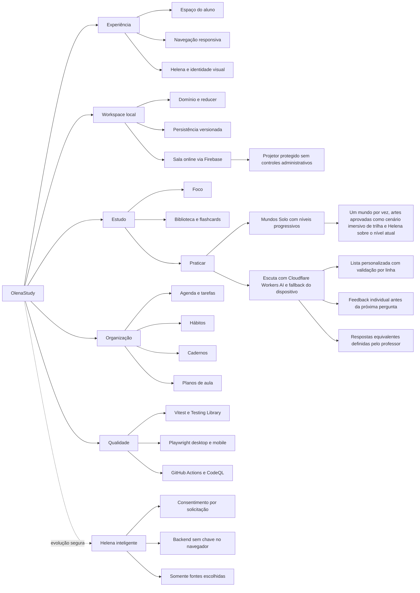

# OlenaStudy: Second Brain

Pop-up corrigido: PomodoroControls só recolhe com collapsible=true no portal; no Foco fica aberto sem seta. loadRiveRuntime(owner=window) mantém cache WeakMap por janela: Rive do pop-up não escuta visibilitychange da origem. Timer instante também usa a janela dona. PaperDigits mantém seu SVG original; a chave por posição/caractere recria apenas o glifo alterado. Duplicar símbolos na janela foi descartado por distorcer seus recortes. Fundo vermelho-claro com tomatinhos só na miniatura, sem rolagem. API PiP não oferece transparência nativa; clique chama requestWindow real, sem simular permissões.

Miniatura acompanha o tomate da PR #495 (ocioso e minhoca no Rive). AnimatedPomodoroTomato aceita sound=false somente no portal: o Foco original continua sendo a fonte do som de mordida. Não criar outra trilha ou outro contador para o pop-up.

PomodoroDial compartilha arte, minhoca e relógio entre Foco e portal. Mensagens usam IDs do catálogo já carregado, sem duplicar os textos no JavaScript. Formato do Pomodoro reutiliza o formatador do cronômetro, com horas somente a partir de uma hora.

PomodoroFloating recebe stage de useDisplayedTomatoStage do Foco e usa AnimatedPomodoroTomato com minhoca, sem uma segunda lógica de progresso. Canvas escuta resize no ownerDocument.defaultView para funcionar no documento flutuante.

Canvas em outra janela não passa no instanceof interno do Rive. AnimatedPomodoroTomato dimensiona o buffer com a janela dona e usa resizeToCanvas nesse caso; ResizeObserver acompanha o layout. Não corrigir distorção mudando proporções da arte.

Miniatura compacta: 320 por 340 px, somente tomate, dígitos e controles recolhíveis. Resumo semanal fica no Foco principal, não é enviado ao portal. Fundo CSS transparente remove a decoração, mas não oferece transparência da janela sobre o sistema operacional.

Mini Pomodoro: PomodoroFloating é portal no documento retornado por pomodoro-window.ts. Recebe relógio, progresso e PomodoroControls de FocusView, nunca roda outra sessão. Uma seta original roxa girada para baixo expande os três botões em linha na aba e na miniatura. PiP nativo mantém a janela no topo; fallback window.open pode ficar atrás de outras janelas. Fecha na desmontagem da aba Foco e conserva o contador ao fechar só a miniatura. Notificações: pomodoro-notifications.ts pede permissão durante clique de início e avisa transições recentes. Não é bloqueio de notificações externas. Testes: pomodoro-floating.spec.ts, pomodoro-controls.test.tsx, pomodoro-window.test.ts e pomodoro-notifications.test.ts.

SVG de avatar exige width/height explícitos de 512 px, além de viewBox. Sem eles Chromium/WebKit podem assumir tamanho intrínseco de 150 px. e2e/profile-avatars.spec.ts verifica o contrato e a transparência.

Segurança, 2026-10-19: /api/account-devices registra/lista acessos autenticados, não revoga sessões Firebase. Registro por navegador/conta em room-limits/account-devices-<hash>, até 30 e 90 dias, limpeza existente por expiresAt. useAccountDevice registra ao entrar e a cada 30 minutos visíveis; configurações consultam sob demanda. Dispositivos anteriores à atualização não são recuperáveis até novo acesso. Sem IP/localização. Saída remove somente o registro deste navegador; excluir conta apaga o conjunto. Não confundir remover registro com encerrar autenticação remota.

Pomodoro: focusPreferences aceita pomodoroMinutes numérico, shortBreakMinutes/longBreakMinutes opcionais com defaults 5/15. pomodoro-duration.ts centraliza limites 1..5999 e formato h/min. Perfil usa RoomStepSlider existente e relógio editável. Sessão recuperada conserva duração e histórico. Testes: pomodoro-duration, pomodoro-duration-picker, account-devices-handler, connected-devices e e2e/pomodoro-custom.spec.ts. Avatares Nicolas=raposa e Guilherme=gato cinza atualizados sem trocar URLs.

Em 2026-10-19, o urso do catálogo passou a se chamar Ninho. O arquivo jairo.webp permanece igual para compatibilidade com avatares já salvos. A única fonte do nome exibido é src/domain/profile-avatars.ts.

Espaço aprovado em 2026-10-19: grade CSS de duas colunas, Foco/Ilha empilhados à
esquerda e NotebookSpread à direita abrangendo duas linhas, também no mobile.
Sem montar StudentFavoritesShelf. Dados de favoritos permanecem preservados.
Prioridades só com pendingTasks; Agenda Hoje só com todayEvents. Regressão:
e2e/student-wide-notebook.spec.ts e e2e/student-resume.spec.ts.

Favoritos móveis: homeFavorite em StudyNotebook, ação notebook/favorite-toggled e helpers
em notebook-shelves.ts. Cap de três itens no total e uma pasta, também após merge/importação.
StudentFavoritesShelf carrega sob demanda só em largura até 760 px. Não montar no desktop.
Prateleira com capas compactas; preview aberto tem largura própria, não o mini preview
do trio desktop. O + seleciona favoritos e nunca cria folhas. Notes/pastas usam arte existente.

Miniaturas do Espaço: readOnly bloqueia personalização, enquanto compactPreview
permite navegar à capa sem montar o inventário. Outros previews continuam sem capa.
Livro com proporção 1.4, max-width 210px e altura automática. Não deformar páginas.
Foco e miniatura compartilham focus-art.tsx e focusFlowerState; ilha usa AnimatedPlace
com fallback otimizado. Só o cartão Hoje abaixo é clicável, não o indicador numérico.
Três previews na mesma linha no mobile, sem textos visíveis e com nomes acessíveis.
Notificações: centralizar contêiner interno, não o main que herda o deslocamento do rail.

XP de salas: recibos canônicos em profile.xpLedger (helena.profile.v1); cache local não
é fonte exclusiva. Mesclar por recibo, nunca somar totais de snapshots nem reduzir o piso.
Não adicionar chave de sync sem allowlist. Curva de nível: 100 + 50 por nível concluído.
Resume notebook/focus fica em profile.studentResume, vencendo timestamp mais recente.
Versão global: número em app-version.json, gerado com system-updates.json; não usar
package.json para rótulo público nem manter versão manual em cada componente.
Sino é rota /notificacoes, Atividades por padrão. Publicar módulos oficiais e agregados
diários estáveis, não respostas individuais; atualização preserva curtidas e leitura.

Matemática: contar somente práticas math/mathematics válidas, nunca futuras. Chama
azul some em 24 h sem prática. Flor: somente Cronômetro positivo salvo cuida da rosa;
conta sem histórico começa murcha. Não congelar Date.now na montagem desses widgets.
Privacidade social: activitySharing ausente significa ativo; false explícito impede publicação.
O carrossel de Oliver substitui o cabeçalho antigo e abre diretamente Matemática.

Configurações: link Termos de uso em Privacidade e dados aponta para TERMS_OF_USE_PATH,
não para o rascunho. Manter o caminho centralizado e preservar a navegação ao abrir.

Saída: SignOutButton sempre permite tentar; useCloudSync valida envio antes do Auth signOut.
Somente descarte explícito pode limpar pendências não confirmadas. Nunca desligar sync
antes de Auth confirmar a saída. Requests com prazo e erro recuperável.

Haptics global inicializado uma vez em main.tsx, não duplicar handlers em telas. Usar
areHapticsEnabled e preferência local haptics de acessibilidade. Sem vibração em digitação.

Conquistas: study-activity-summary lê apenas registros salvos no servidor; cliente não
manda texto de post nem pontuação. ActivityPrivacy confirma consentimento servidor.
SocialActivityPublisher agrega mudanças após upload; profile-social-handler faz CAS,
limites, curtidas e revogação. Não expor UIDs/hashes ou conteúdo privado no feed.
Avisos usam stream existente e socialNoticeId distingue follow, atividade e curtida.

Pronomes: profilePronounsLabel traduz apenas os três valores predefinidos. Nunca aplicar
uiText ao campo livre nem regravar helena.profile.v1 ao mudar idioma. Settings haptics usa
eventos confiáveis de interação, com captura de clique para ações e de change para escolhas,
evitando duplicar a vibração do checkbox. Cabeçalho tem marcador de tratamento próprio.

Preview Helena: o HTML independente também precisa aguardar initializeLanguage antes de
importar a interface. Não comparar títulos traduzidos para identificar a aba Agenda.
Fixtures de retomada de Foco devem ser instaladas por addInitScript no próximo documento,
não adulteradas antes de reload enquanto o documento atual ainda pode salvá-las.

2026-10-18, idiomas: runtime em src/i18n, catálogos estáveis em public/locales.
uiText para interface confiável, nunca dados pessoais ou texto livre. useLanguage atualiza
componentes sem remontagem; localizeLabels evita congelamento no escopo de módulo.
Não traduzir IDs, valores canônicos do onboarding ou respostas. Datas manuais variam entre
dia/mês e mês/dia, armazenamento ISO permanece igual. Manutenção e testes em I18N.md.

2026-10-18, futura ponte de atendimento: contrato server-only em support-integration.ts,
desativado e sem runtime Discord. Plano e modelo de ameaça em SUPPORT_DISCORD_PLAN.md.
Não ligar um envio externo direto depois do salvamento: implementação futura exige outbox
atômica, revalidação de exclusão e autorização própria dos IDs de atendentes do Discord.

2026-10-17, nomes em conexões móveis: Person coloca Segue você dentro da coluna de identidade, abaixo do @. Min-width zero na coluna, avatar/ação sem encolher e nomes/@ em linha única com ellipsis e title completo. Evita a quebra letra por letra provocada pela relação na terceira coluna do botão.

2026-10-17, CI de notificações: hideBell em SystemUpdates omite details/painel do DOM, não o componente inteiro. Mantém feed, toast e SocialVisitListener ativos no Perfil, preservando contrato dos E2E notification-panel e profile-privacy-header sem alterar suas asserções.

2026-10-17, latência de contagens do Perfil: useSocialFeed compartilha promessa e último resultado em memória por UID confirmado entre sino e Perfil, sem nova chave de armazenamento. Perfil deixa de serializar essa consulta após useProfileHandle. Eventos sociais invalidam cache uma vez por evento, enfileiram atualização quando necessário e rejeitam resultado anterior à invalidação. Falha conserva números já confirmados; logout/troca de UID limpam o cache. Sem resposta inicial, contagem fica ausente, não é zero inventado nem reticências. ProfileStreaks apresenta zero imediatamente quando não há sequência no workspace carregado.

2026-10-17, refinamento do Perfil: profileLevel passa a usar XP do ledger de RoomRewardNotice, não pontos das ilhas. Custo por nível 500 + 250 por nível já concluído, sem alterar recibos ou total. Evento ROOM_XP_CHANGED atualiza a barra. Ledger existente continua sem sincronização remota, não prometer continuidade entre aparelhos. NotebookSpread tem readOnly para prévia do Perfil; Cadernos aceita folha apenas se pertencer ao caderno no próprio workspace. SystemUpdates mantém feed sem sino no Perfil e revela aviso temporário somente para novos eventos recebidos, nunca histórico inicial. Botão QR abre SocialDirectory com initialSharing.

2026-10-17, rótulos de @pranksterbrain: ProfileLabels reutiliza as placas CREKS e BETA TESTER a partir do identificador confirmado, sem DEV, GALAXIA ou privilégios extras. Teste parametrizado junto a @eito cobre ficha e barra compacta, sem aceitar cache divergente.

2026-10-17, integração de XP no perfil compacto: gap móvel de profile-cover__details é 6 px para conservar a ficha abaixo de 520 px com bio/rede no teste profile-covers, sem diminuir avatar ou alvos de toque.

2026-10-17, rótulos públicos: ProfileLabels mostra GALAXIA e BETA TESTER para o identificador confirmado dreyxnn, incluindo ficha, barra recolhida e perfil visitado. Não concede CREKS, DEV ou permissões. Cache de nome de usuário não autoriza rótulos. Regressão em profile-showcase.test.tsx cobre cache divergente e a grafia distinta dreyxn.

2026-10-16, revisão móvel: ProfileShowcase separa profile-toolbar sticky de profile-chrome; no celular a ficha usa fluxo natural e avatar 112 px, enquanto desktop mantém o recolhimento. ProfileCoverArt carrega cinco SVGs estáticos de public/profile-covers, sem imagens remotas ou arte dentro do JavaScript. Fonte vetorial em scripts/profile-cover-art.tsx, regeneração por node scripts/build-profile-covers.mjs. ProfileCoverDialog grava apenas cover permitido em helena.profile.v1 via writeSyncedStorage, mesclando com readStoredProfile no instante de salvar. Tipos/fallback em domain/profile-covers. Seguidores/Seguindo voltam como indicadores de zero inicial a pedido do proprietário, substituindo a ocultação da etapa anterior. Ícone settings é compartilhado no PaperEditorIcon com os cadernos.

2026-10-16, trajetória real: ProfileOverview combina focusSessions, practiceActivities e quizAttempts, ordena por instante e limita a cinco no conjunto, sem mutar workspace. Chaves incluem a origem para evitar colisões. Sem grafo social, ProfileShowcase não mostra Seguidores/Seguindo; mantém streaks reais. Esta decisão substitui os zeros de protótipo descritos abaixo.

2026-10-15, ficha do Perfil: tema só em Aparência e acessibilidade; PageHeader mantém useTheme ativo sem botão visual, no mesmo ponto de aplicação anterior. ProfileEditor usa diálogo nativo e helena.profile.v1 existente. name é Apelido; username minúsculo não é identificação pública única; bio/pronouns/socialLinks são opcionais. Validar links em domain/profile-identity, sem fetch/credenciais. Preservar extras ao trocar avatar e mesclar a foto atual ao salvar rascunho. Não migrar nem limpar perfis antigos na leitura. Seguidores/Seguindo são apenas indicadores visuais sem contagem: não existe backend social. E2E profile-editor cobre cancelar, erro, foco, pronomes personalizados e redes nos dois temas; theme-setup prepara temas de cenários não relacionados sem depender do botão removido.

2026-10-15, protótipo visual do Perfil: ProfileShowcase mantém uma identidade/avatar que se recolhe em barra sticky por variável CSS atualizada via requestAnimationFrame. Usar useStoredProfile e respeitar Guest, sem nova persistência. ProfileOverview reutiliza ProfileProgress e cinco focusSessions recentes; nunca inventar rede social ou duplicar IDs do progresso ao abrir configurações. Capa compartilhada profile-people.webp documentada em PROFILE_COVER_ART.md: humanos pequenos facetados, sem boca, com bigodes dos rapazes. Não incluir fotos pessoais de referência no repo. Respeitar reduceMotion do app e do dispositivo. E2E profile-showcase.spec.ts cobre scroll reversível, temas e controles PC/celular.

2026-10-15, ajuste visual: Configurações é ação somente de ícone no cabeçalho do Perfil, via PageHeader.leadingAction, à esquerda do tema e com placa creme. HelenaMascot usa exclusivamente arte do mesmo Rive: star-rive.png/helena-rive.png exportados por scripts/export-helena-poses.mjs. Imagem e canvas compartilham geometria; runtime sem atraso inicial e ciclo começa em ready, não antes da carga. Falha e movimento reduzido conservam o quadro original. Não substituir esses quadros por favicon/PNG de outro modelo.

2026-10-15: Perfil abre a central pelo botão Configurações (PaperEditorIcon.settings); manter a seção atual ao recolher. Avatares só em Conta, não no cabeçalho. PageHeader.showUpdates é true somente em TodayView. PrivacyNotice aparece após entrada no app, guarda leitura versionada em helena.privacyNotice.v1 (local, limpa com dados pessoais) e pode ser consultado em Privacidade e dados. Não é consentimento para IA/voz/integrações. HelenaMascot preserva o Rive 2D original e seus ciclos. Somente fallback: favicon-star.svg e helena-2d.png, sem as imagens antigas 3D.

2026-10-14, central do Perfil: profile-view organiza sete seções em navegação local, com estilos uniformes em profile-view.css. Profile-preferences reutiliza os estados existentes de identidade, tema, cadernos e conta; NotebookPreferenceFields é compartilhado com o editor. useTheme observa eventos locais, remotos e de outra aba para manter os atalhos coerentes. ACCESSIBILITY_KEY mantém leitura dos booleanos antigos e acrescenta soundEffects (padrão true); a preferência é deste dispositivo e não silencia conteúdo falado. Perfil exporta somente dados carregados e chaves sincronizáveis, sem tokens. Hábitos não tem mais tela, catálogo, métrica ou ações; o campo habits permanece somente como leitura legada do workspace, para compatibilidade/rollback. /habitos resolve para profile. Não apagar registros nem inventar conversão automática em agenda. Cursores paper-text/paper-grab são SVGs nativos de 32 px, usados somente por mouse, preservando ferramentas e cores forçadas.

2026-10-14, Poeira cósmica: math-place-rewards mantém o formato v1 e o sorteio anterior; novo unlockAt nasce em Date.now()+10000. unlockMathChest usa o menor prazo, permitindo preparar legados sem reiniciar contagem. MathPlaceTreasure prepara pendências antigas e apresenta um único CosmicDustArt; kind/arcana continuam como compatibilidade de conteúdo. OliverCardBooster revela a raridade em quatro toques sem reroll, passa diretamente à OliverCardInspection compacta e fecha com animação idempotente. X/Escape não abrem coleção nem disparam voo de armazenamento. Oliver-rarity define identidade visual fixa das cartas e cores semânticas; chances continuam transparentes. Cosmic-dust.css concentra efeitos e movimento reduzido. MathIslandJourney interpola a porcentagem visível e seus recortes por 750 ms, sem gravar valores intermediários. Rollback preserva v1, conteúdo e prazos de 10 s; não apagar pendências nem renomear a chave. Testes: arcane-chests.spec.ts para legado/fechamento/arraste e cosmic-dust.spec.ts para cores, temas e movimento reduzido.

2026-10-14, notação legível: formatMathNotation pertence apenas à apresentação de MathArcade, inclusive aria-label. Não normalizar o banco compartilhado para não alterar contratos publicados ou identidades. Inteiros usam sobrescrito; expoentes não representáveis mantêm delimitadores; derivada avaliada em ponto recebe descrição explícita, distinta de valor da função. Texto ambíguo não é adivinhado. Regressões: math-notation.test.ts e final de Cálculo I em math-finals.spec.ts. Testes de Agenda devem delimitar a região quando há dois botões legítimos com o mesmo nome e aguardar geometria pós-animação; instalar relógio antes das animações, mas pausar só depois de carregar a página.

2026-10-14, matemática v5: math-mastery-progress.ts possui confirmed, final parcial de cinco respostas, finalSeen, cooldown e recuperação com resolução persistida; math-mastery-engine.ts seleciona variantes diferentes por família de erro e exige 4/5 na final. Treino v4 não perde crédito; conquistas v3/v4 são reconhecidas. math-game-learning.ts escreve somente helena.mathGame.v5 e une os legados sem modificá-los. Finais usam índices 48..71 de challengeQuestion e sementes 289..432, sem alterar treino 0..47. API version=5 compartilha motor local e mantém contratos anteriores. Sem LLM ou HTTP por resposta. Regra stateV2 publicada com guarda de presença v5, conferida contra candidato: aba antiga que omite a chave precisa recarregar. Rollback conserva chave/leitor/escritor v5. Testes novos: math-mastery.test.ts e math-finals.spec.ts, com seis lugares, finais parciais, offline, teclado, temas, celular e recuperação. Reserva de variantes não equivale a banco pedagógico validado; revisão humana continua pendente.

2026-10-13, alternativas e consistência: math-choice-errors.ts possui candidatos por cada um dos 144 formatos originais; math-challenge-bank.ts aplica limites de grandeza, filtra colisões e publica revision 3 sem mudar IDs/gabaritos. Formatos extras mantêm candidatos próprios. nextChallenge intercala retomadas de acertos a cada oito tentativas, respeita quatro IDs recentes e usa quantidade vista para rotacionar inéditas, sem crédito duplicado. Novas etapas mistas precisam de 20 IDs, oito formatos e quatro variantes difíceis; conquistas existentes e crédito v3 são preservados. challengeCompletion é dono dessa regra, mergeChallengeProgress deve unir os bits mastered para preservar desbloqueios antigos. Sem nova chave/campo nem dependência. MathArcade usa mínimo entre reserva e prazo individual no relógio principal, mas só expira uma questão quando o prazo individual vence. Testes: math-choice-errors.test.ts e math-arcade.test.tsx, mais os fluxos e2e existentes. Não confundir dificuldade editorial, 100% do minigame ou alternativas autorais com validação pedagógica/certificação.

2026-10-13, minigames v4: math-challenge-bank.ts conserva as 864 entradas originais por bankQuestion e acrescenta 864 variantes autorais, em quatro formatos novos por etapa. São 48 entradas/oito formatos por etapa, não 1728 modelos independentes. ID extra separado, revision 2 nas alternativas; v3 continua congelado para API/abas antigas. math-challenge-engine.ts alterna formatos e dificuldades, usa 4 IDs recentes e fila de erros com atraso de 4 outras respostas, sem HTTP por resposta. Nota review é metadado editorial de auditoria, não aula mostrada no jogo. math-challenge-progress.ts é dono das máscaras extras, validação, merge e percentuais. math-game-learning.ts passa a ler v4 unido com v3 e a escrever só v4. Não trocar nomes/semânticas de slots publicados. API v4 e SYNCED_STORAGE_KEYS têm chave nova, com regras Firebase existentes. A placa da porcentagem usa seis recortes roxos por etapa, sem texto de falta nem loading amarelo. Manter testes math-quality.spec.ts e math-challenge-quality.test.ts junto dos fluxos anteriores. Revisão pedagógica humana e calibração continuam pendentes.

2026-10-13, minigames e progressão v3: MathArcade usa requestMathGame/assessGame/gameQuestion, com banco fechado em math-game-bank.ts. Quatro formatos por etapa, seis variantes fixas por formato, 24 entradas por etapa, seis etapas por lugar. Vinte IDs acertados por etapa completam o lugar em 120 acertos distintos e liberam o próximo. Erros/repetições não apagam/inflam conclusão. math-game-progress.ts é dono das invariantes, validação, porcentagem, bloqueio e merge. Máscaras solved/seen pertencem a helena.mathGame.v3, sincronizada automaticamente; sync-conflict usa união por identidade. Histórico v1/v2 preservado, sem equivaler seis acertos antigos à regra nova. API action=math&version=3 compartilha o motor offline, sem HTTP por resposta; v1/v2 continuam compatíveis. A placa acima do avatar mostra concluído/falta. Manter futuras aulas fora das ilhas. Primeiro banco inclui 861 variantes autorais e três adaptações de Thompson com procedência; ainda sem revisão pedagógica humana nem dificuldade calibrada. Não alterar IDs/semântica de entradas publicadas sem versionar máscaras e contrato. Ver docs/MATH_BANK_IMPLEMENTATION_PLAN.md.

2026-10-13, revisão do rail: proprietário rejeitou a expansão automática. Sidebar voltou ao único estado de abertura manual; navigation-refinements mostra dicas pequenas de papel nos rótulos existentes por hover/focus-visible, mantendo 84 px. Validar claro/escuro, Perfil, item ativo, teclado e abertura manual no teste agenda-task-navigation. Não reintroduzir sidebar--preview ou reposicionar o conteúdo ao inspecionar ícones.

2026-10-13, tarefas e navegação: StudyTask.color é opcional e validado como hex de seis dígitos, persistido e sincronizado no mesmo workspace dos eventos. AgendaColorPalette aceita rótulo para reutilização em tarefas. AgendaCalendarViews dimensiona faixa compartilhada para até três itens sem cortar bases de papel e ajusta o eixo horário. Sidebar reutiliza o menu expandido para alargar temporariamente a barra de 84 para 260 px por hover sobre ícone ou foco, sem etiqueta solta, deslocamento do conteúdo ou mudança na navegação móvel. Regressões: task-color.test.ts e agenda-task-navigation.spec.ts em desktop/mobile.

Matemática usa action=math&version=2 para consumidores das conquistas. version=1 mantém contrato e avanço legados. O catálogo geral continua v1. Respostas mais novas de abas v1 são reconhecidas na leitura, preservando conquistas v2 e reiniciando só a sequência parcial incompatível.

2026-10-13, Matemática: requestMath calcula imediatamente com o mesmo mathChallenge/assessMath da API, sem HTTP durante a partida. Domínio do desafio exige seis acertos seguidos por tema; mastered é máscara de seis bits, celebra uma vez e preserva conquistas ao recuar. Todos os temas completos encerram a rodada e sugerem o próximo lugar. MathArcade pausa a contagem no cartão de conquista e reutiliza papel, partículas e createMathSound. v2 amplia progresso e sincroniza pela conta; v1 é espelho compatível, fallback de leitura e não recebe os campos novos. Merge conserva máscaras e melhor pontuação; não somar contadores de respostas replicadas. Na Agenda, metadados úteis ficam visíveis sem summary Detalhes.

2026-10-12, teste de mover tarefa para hoje: não comparar data da conta com new Date() do runner UTC. Fixar relógio e fuso da conta no fixture e exigir datas literais antes/depois de meia-noite brasileira. Produto permanece inalterado.

2026-10-12, busca da Agenda: botão/Enter ativam Lista de resultados sem limite do mês aberto. agendaSearchDate escolhe uma ocorrência válida por série, sem materializar rotinas infinitas; filtros compartilham normalização de acentos/caixa/espaços. Limpar volta aos próximos 30 dias. loadPaperExportMascot carrega e reutiliza /olena-favicon.png original no selo, sem redesenhar Helena; erros permitem tentar novamente.

2026-10-12, exportação autoral: paper-export-art produz moldura de cópia, selo Helena/estrela e marca d'água; não usar no autosave. agenda-event-png gera cartão local e AgendaEventShare prepara prévia antes do clique nativo de compartilhar, com download alternativo. PNG restrito à Lista, sem e-mails/anexos/histórico; .ics da barra preservado. Paleta fixa mantém valores antigos sem migração. Grade mostra ghost do ponteiro, Escape cancela e alça de duração permanece dentro do bloco. Remoções de avisos e dicas não alteram contexto de Foco, sincronização ou acessibilidade da Helena.

2026-10-12, Agenda compacta: AgendaFilters reúne os dois filtros em popover. Grade salva movimento/redimensionamento ao soltar; rotinas destacam só a ocorrência via changeSeries, sem mover histórico. Alt/setas ajusta horário e Shift/Alt/setas muda dia. Cor opcional hexadecimal integra StudyEvent, validador local e merge por campo; marcadores coloridos mantêm texto neutro legível. Permissão de notificações aparece em aviso temporário de 6 segundos com sino, barra e cooldown, em vez de texto permanente. Desktop agrupa painel do dia abaixo de Meu estudo; mobile mantém ordem calendário/dia/estudo.

2026-10-12, prova de navegação responsiva: aguardar aria-current="page" antes de medir o ícone ativo após troca para Agenda. O carregamento sob demanda pode manter temporariamente a página anterior; não comparar a posição de ícones em estados diferentes nem remover a animação para esconder a corrida do teste.

2026-10-12, detalhes da Agenda: marcador de estado confirmado descarta stream/GET anterior a PUT recente, evitando remoção falsa de eventos; PUTs do mesmo cliente são serializados. Fuso brasileiro automático sincroniza por helena.agendaTimeZone.v1, não usa geolocalização nem cadastro inexistente de cidade. AgendaDurationClock/agenda-duration controlam ponteiros, teclado, virada de hora e limites. AgendaMetadataField expande campos com resumo. RoomStepSlider recebe formatValue e ID único fora dos controles da sala, reaproveitando arraste para lembretes. AgendaAttachmentPreview mostra imagens reais em todas as visualizações; drop/seleção compartilham validação existente. Toolbar mantém placas creme, textos e os ícones cloudUpload/download da escrita.

2026-10-18, arte do Oliver animada em Rive: OliverHeroArt (usado por MathPracticeHero) toca public/oliver-math-islands/oliver.riv sobre a imagem estática, que segue como elemento acessível e primeiro quadro. O arquivo é gerado por scripts/oliver-rive (slice.cjs fatia a arte em 25 camadas, generate.cjs monta o binário, saída determinística, README com o rig e a verificação). Máquina "Oliver": camadas Base (ambiente de 12 s), Reacao (clique 1 a 3: pulo, aceno, ânimo) e Olhar (olharX de -1 a 1). Reaproveita o runtime do Rive de src/data/rive-runtime.ts; movimento reduzido não baixa nada. Comandos: node scripts/oliver-rive/slice.cjs (se a arte mudar) e node scripts/oliver-rive/generate.cjs. Teto do arquivo em performance:check: 512 KiB.

2026-10-13, mascote do assistente em Rive: HelenaMascot desenha a Helena num canvas com o
runtime oficial do Rive (@rive-app/canvas 2.43.0, MIT), vendorizado em public/helena-assistant
(rive.js, rive.wasm) e carregado sob demanda por src/data/rive-runtime.ts, fora do bundle. O
arquivo public/helena-assistant/helena.riv é gerado por scripts/helena-rive (slice.cjs fatia o
favicon, generate.cjs monta o binário, saída determinística). Máquina "Helena": entradas aberta,
arrastando, lado, atenta, olharX e clique. O componente passa só estado visual (aberta, arrasto e
inclinação, ponteiro por perto); nada da conversa ou da conta. Recolhida, alterna estrela por
2,8 s e Helena por 13 s, segurando a Helena com o ponteiro por perto; ao recolher a conversa volta
a ser estrela na hora. Interação em outras telas pausa o desenho por 1,5 s; modal aberto e aba
oculta também pausam. Movimento reduzido não baixa nada e mostra as imagens estáticas. O span
expõe data-ready, data-form, data-state e data-behavior para os testes. O three.js e o modelo
3D foram removidos. Orçamento próprio em npm run performance:check.

2026-10-12, publicação Firebase: validação de users/$uid/stateV2 aplicada e relida no projeto appstudyoli, instância appstudyoli-default-rtdb. Apenas o novo filho foi acrescentado às regras obtidas do servidor; todos os demais nós e permissões foram preservados. Não publicar o arquivo completo do repositório sem comparar com as regras atuais, pois contém validações legadas que não estão em produção. Cliente novo ainda precisa ser implantado.

2026-10-12, transporte da conta: Realtime Database rejeita pontos nos nomes de filhos. cloud-state-codec converte só nomes sincronizados para base64url k_, sem mudar valores/chaves locais. Cliente escreve em users/{uid}/stateV2 (version 2), lê state como fallback de migração e não o altera. Isso impede clientes antigos de receber um formato desconhecido e apagar o cache. Publicar regras expandidas antes do cliente, atualizar abas e manter codec v2 em rollback. Detalhes em ACCOUNT_SYNC_SETUP.md.

2026-10-12, Foco e Agenda pela conta: histórico concluído de Foco é aditivo por ID, dias Pomodoro são unidos e a primeira carga preserva registros pendentes antes do reload. useWorkspace atualiza IndexedDB ao receber dados e impede hidratação tardia após edição/conta. olena.focus-session.v1 passa a sincronizar snapshots válidos mais recentes; deviceId opcional pausa recuperação em outro aparelho até ação explícita. Snapshot vazio inicial não apaga sessão da conta; compartilhamento por controles/intervalos de 30 segundos. Conexão recuperada repete GET inicial. AgendaToolbarIcon aplica símbolos sem texto em papel creme; data muda no seletor existente. Regra de conta e limites em AGENTS.md e docs/AGENDA.md.

2026-10-12, agenda interna ampliada: agenda-calendar concentra recorrência, fuso, projeção e escopos; agenda-ics valida intercâmbio sem duplicar UID; agenda-grid-layout distribui conflitos na grade. Planner confirma movimento antes de dispatch event/series-changed. AgendaReminders é carregado sob demanda, guarda fila local por conta e não oferece push fechado. Eventos/tarefas usam merge por campo com reconciliação existente. Metadados opcionais mantêm workspace v7; clientes antigos precisam atualizar para editar recursos avançados. Google bidirecional e colaboração remota ficam para etapa posterior. Fluxo e limites em docs/AGENDA.md.

2026-10-12, cursor autoral: paper-cursor.css usa SVGs locais de seta e mão facetadas com hotspots explícitos e fallback nativo. Somente mouse fino com hover e fora de forced-colors; sem JavaScript. Texto e ferramentas mantêm cursores semânticos, mobile não muda. Sem alterações de persistência ou sincronização.

2026-10-11, layout responsivo da Agenda: overview em duas colunas a partir de 1200px; calendário e painel do dia agrupados à esquerda, Meu estudo à direita. No celular, sete indicadores de Foco e três ações permanecem em uma linha compacta. Textos auxiliares solicitados e widgets Google/Listas removidos somente da tela, preservando armazenamento e sincronização.

2026-10-11, Agenda compacta: removido o widget Uma semana possível. Painel do dia passa a compartilhar largura máxima/centralização de 860px com calendário e Meu estudo. Cabeçalho da data é texto comum e mantém foco programático sem efeito amarelo; controles continuam com foco visível. Demais números do calendário preservados. paper-controls.css bloqueia seleção de controles/ícones, preservando texto comum e campos editáveis. Sem alteração de armazenamento, sincronização ou dados.

2026-10-11, último acabamento antes do merge da Agenda: AgendaActionIcon inclui edit com asset SVG de lápis de papel; tarefas e compromissos mostram só o ícone, mantendo aria-label/title e o editor existente. Editar e check ficam em grid centralizado de 44px, com cantos e padding uniformes. Sem dependências ou mudanças de estado.

2026-10-11, correção dos dados da Agenda: agendaDashboard não trata subjectId padrão do Foco como seleção de matéria; pizza por dia. Estante distingue cadernos, pastas e Notes, mostra títulos e conta cada notebook uma vez, sem duplicar a página da Note. AgendaIslandProgress recebe seleção controlada, limita cursos às atividades positivas do período e filtra os gráficos ao navegar. overdueTasks exige prazo válido vencido e tarefa não concluída. Widget duplicado de matérias/metas removido sem apagar dados; semana mostra sete dias clicáveis com pendências reais. Ano sem PaperDigits, menus com contraste explícito no hover/foco. Não altera persistência ou merge.

2026-10-11, formulário original da Agenda: botão Adicionar do topo removido, ações nos dias. AgendaActionIcon serve SVGs próprios (study/appointment/once/weekly) somente na rota. PaperChoice, PaperDateField e PaperTimeField substituem menus/pickers nativos por popovers de papel; máscaras numéricas e validação preservam datas/horários. Matérias derivam de PRACTICE_ISLANDS, reaproveitam IDs e adicionam IDs estáveis subject-island-<id> somente no salvar; reducer ignora ID já existente, merge continua por ID. Legacy personalizado permanece na edição. X coloridos sem placa globalmente em paper-controls.css; PaperEditorIcon grafite/creme é exceção documentada em AGENTS.md. Check existente amarelo/grafite com encaixe, seleção de dias, barras, rosca e popovers animados com movimento reduzido. Nenhuma migração destrutiva ou dependência nova.

2026-10-11, Agenda e atualização beta: Adicionar/dia abrem folha contextual com ações para tarefa, estudo ou compromisso. Formulário reutiliza workspace/reducer/merge por ID; data, horário e marcação do calendário sobrevivem à recarga. Feriados nacionais usam brazilian-holidays.ts (Computus e datas fixas); não inclui feriados locais nem pontos facultativos. Ilhas com arte centralizada de 80px, sem texto de sequência ou instrução visual; categorias vazias explicam a falta de registros. SystemUpdates é lazy no cabeçalho antes da aparência. Feed próprio gerado no build Vercel a partir de PRs mescladas na main até aquela revisão, versões beta.<PR>. Leitura usa chave sincronizada helena.systemUpdates.read.v1, união de IDs no login/merge, atualização por eventos e limpeza por conta. Ver docs/SYSTEM_UPDATES.md para limites e fallback. Sem dados do aluno no GitHub, serviço pago ou dependência nova.

2026-10-11, Agenda: Praticar usa somente practiceActivities do dia/intervalo selecionado. Sem respostas positivas, oculta gráficos, prévias e indicadores. Progresso legado sem data continua salvo em Matemática, nunca atribuído ao calendário. Um par de gráficos por período/ilha, sem recordes acumulados duplicados. Prévia compacta com arte de até 110px e respostas/acertos filtrados, seis ilhas, setas roxas, teclado e arraste. Sequência matemática usa acertos datados por rodada. Semanas de flores/tomates continuam visíveis sem minutos, conforme exceção solicitada. Inspeção em itálico; sem botões Abrir. Bingo presencial usa papel creme e texto grafite em ambos os temas. Sem mudanças no esquema ou treinamento.

2026-10-10, professor Helena: api/helena.ts monta handler autenticado e limites
Firebase compartilhados. Chat real exige consentimento por sessão, envia nome
da tela e histórico curto, sem gravação ou treinamento de conversas. Preview
continua local. CloudflareTeacher usa credenciais privadas e timeout; a Olena
avaliada pode assumir capacidades via createProgressiveProvider sem chamada
externa no sucesso. Scripts olena-learning.mjs e train-olena.py separam rascunho,
revisão por hash, exportação e treinamento LoRA explícito. Não existe modelo
treinado ou job automático nesta entrega. Configuração, ameaças, avaliação e
rollback em docs/OLENA_LEARNING.md. Testes do pipeline: node --test
scripts/olena-learning.test.mjs.

2026-10-10, integração Helena: AppContent monta HelenaChat por lazy import fora
do Suspense das abas. Estado sobrevive à navegação. Arquivos compartilhados agora
são helena-chat.tsx/css/test.tsx; preview reutiliza o componente com preview=true.
Não aparece no onboarding/projetor e fica oculto sob diálogos modais. Breakpoint
de 900px evita conflito com a barra móvel. Respostas ainda são demonstrativas,
sem API ou armazenamento. Prova no app real: e2e/helena-app.spec.ts.

2026-10-10, preview local Helena: preview-helena-chat.html demonstra chat com
estrela original RoomPointsIcon, sem IA/API, sincronização ou persistência.
HelenaChatPreview captura mouse/toque, limita a posição e encaixa na borda;
limiar de 6px separa clique de arrasto. Estados de movimento controlam flutuação,
inclinação, abertura, fechamento, arrasto e pouso. Fechamento aguarda 220ms,
exceto com movimento reduzido. Testes focados cobrem conversa, toque, teclado,
fechamento e arrasto/encaixe em desktop e viewport móvel. Não integrado ao app.
Prova do preview: npx playwright test --config playwright.helena.config.ts.
Servidor Vite separado do smoke de produção, sem adicionar a demo ao bundle.

2026-10-10, tempo das questões: MATH_COURSES define initialQuestionSeconds por etapa
(14, 16, 18, 20, 22 e 24 s do fundamental ao cálculo III). mathQuestion soma 3 s
por tópico e mantém a aceleração existente. mathResponse valida budget e drain
contra a questão regenerada, evitando uma fórmula fixa divergente. Reserva total
da partida permanece em 60 s, sem alteração de recompensas ou progresso.

2026-10-10, contador dos lugares: MathIslandJourney conserva o último número exibido
entre montagens de MathPlaceTreasure. A interpolação de 900 ms parte desse número
para o saldo do lugar selecionado, incluindo descida até zero. Trocas rápidas
retomam do valor intermediário; movimento reduzido aplica o alvo sem interpolar.
Somente exibição, sem modificar pontos/baús salvos ou manter booster de outro lugar.

2026-10-10, feedback matemático: MathArcade mantém acertos por 650 ms e erros/timeout
por 1300 ms após a API confirmar, sem descontar latência. Som e pontuação usam o
mesmo resultado confirmado; não há loading por resposta. Reserva pausa durante a
requisição e feedback, duplicatas são bloqueadas e falha pode ser reenviada sem
premiar antes da confirmação. Provas: math-arcade.test.tsx e math-answer-feedback.spec.ts.

2026-10-10, encaixe compacto: removida a altura mínima rolável de math-journey-content.
Uma viewport fixa; posições da ilha, baús e legenda derivam de math-scene-size.
Margens e slots menores reservam a ação sem scroll. Prova: math-journey-fit.spec.ts.

2026-10-10, correção: MathIslandJourney preserva a escala original dos lugares,
com math-journey-content rolável em telas baixas. OliverCard usa draggable=false
nas artes e bloqueia dragstart; CSS impede seleção e callout apenas nas cartas.
Booster e inspeção previnem o comportamento nativo no início do gesto. Provas:
e2e/card-integrity.spec.ts (todas as onze cartas) e escala em arcane-chests.

2026-10-10: MathChestArt desenha comum e arcano no padrão de papel. MathChest mantém
cards comuns e acrescenta kind/arcana à chave v1; chestCards unifica apresentação
e coleção, mergeMathRewards conserva identidade e acusa diferenças. Arcano 5%
por rodada elegível, uma A Estrela, mesmos três slots e minuto. CHEST_REWARDS.md
documenta política, compatibilidade e extensão. Booster oferece inspeção imediata;
tarot tem película óptica e arte sem recorte. Feedback do minigame, corrigido após
regressão por latência, dura 650/1300 ms após confirmação, sem loader por resposta.
API continua obrigatória.

2026-10-10, documentação e ambiente: README, ARCHITECTURE, PRODUCT_MIND_MAP, IMPLEMENTATION_ROADMAP e
ROOM_SETUP foram atualizados para o estado real (Praticar, Matemática, cartas do Oliver, Modo Sala
com remoção e fechamento de entrada, Olena API, funções de `api/`, orçamentos de bundle atuais). O
catálogo `src/product/module-catalog.ts` ganhou `handwriting` e `room` como disponíveis, e `ocr`
continua planejado só para digitalizações, pois o OCR local existe apenas na seleção de traços. O
arquivo `.env.example` foi removido do repositório por decisão do dono: a lista de variáveis agora
vive nos guias de configuração (`ROOM_SETUP.md`, `ACCOUNT_SYNC_SETUP.md`, `GOOGLE_CALENDAR_SETUP.md`)
e no painel da Vercel. O e2e do CI roda um projeto por job (desktop e mobile).

2026-10-10: PaperCardTitle reutiliza símbolos SVG do alfabeto monocromático com acentos. OliverArtworkId separa a vitrine do tarot XVII, A Estrela, dos dez OliverCardId comuns. OliverCardInspection atende ambos, sem alterar chances ou inventário. Arte WebP nova em public/oliver-cards; detalhes de geração em TAROT.md.

2026-10-10, revisão visual: baú comum madeira/cinza, prêmio tocável voa ao slot
no retorno do minigame. Espera salta, barra roxa e pronto avisa uma vez. Booster
permite arraste livre; Guardar anima todas as cartas e abre coleção com flip das
recebidas. OliverCardInspection gira frente/verso em 360 com CSS, mouse/toque e
setas. Ícones autorais compactos nos atributos; título acima da lore, raridade
na moldura. Sem nova dependência. Persistência e sync anteriores preservados.

2026-10-10, sincronização: mathPlaceRewards.v1 agora é uma chave de conta.
writeSyncedStorage agenda envio; math-rewards-sync une rounds por ID, baús e
revelações. Importa dados locais se nuvem antiga não tem a chave. Totais legados
e sorteios concorrentes ambíguos geram backup/conflito. Três slots visíveis,
extras concorrentes preservados em fila. Troca de conta limpa e fecha a partida.
Ver docs/MATH_REWARDS_SYNC.md para migração, reversão e limites de segurança.
Substitui descrições de persistência somente local abaixo.

2026-10-10, cartas do Oliver: MathPlaceTreasure agora mostra três espaços sob a
arte. Toque no baú destranca em 60s e abre um booster de uma ou duas cartas,
verso Olena, flip por toque/arraste, sons e contador restante. OliverCardCollection
mostra cópias, atributos ficcionais, lore e chances. Dez cenas independentes em
public/oliver-cards (WebP responsivo, prompts no README). drawOliverCards usa
crypto: 80% uma, 20% duas; pesos individuais somam 100%. Tudo comum.
math-place-rewards adiciona cards/revealed opcionais no schema local v1; sorteio
salvo antes de mostrar, retomada parcial sem rerrolagem e coleção derivada das
revelações. Baús abertos antigos preservados sem itens retroativos. Limite três
pendentes por lugar para novas recompensas, pontuação continua acumulando quando
cheio. Não confundir com economia de conta remota ou bônus no minigame.

Matemática agora guarda pontos por lugar e baús comuns locais em
helena.mathPlaceRewards.v1. Uma partida com 100+ pontos concede um baú; destrancar
aguarda 60 segundos por prazo persistido, então abrir anima a tampa. Não há itens
internos definidos nem recompensa remota. MathPlaceTreasure reaproveita ícone e
dígitos de pontos; SVG facetado próprio para o baú. XP zero não exibe aviso.
Reserva inicial cheia após 3-2-1, imagens 34% menores e prioridade responsiva,
setas de Praticar/Foco e arraste coexistem. Entrada: Explorar Matemática.

Matemática: lugares horizontais de uma única ilha, em math-islands/places/. Cada
cenário é reconstruído inteiro com elementos da arte original, sem cortes de um
panorama. O clique na arte de disciplina ou de lugar também abre a etapa.
entryOrigin mede a foto antes da troca de tela e preserva sua posição no início
do voo. Moldura com largura/altura iguais, sem avatar no feedback de resposta.
Olena recua um assunto após dois erros consecutivos. MathProgress.errors é
opcional para manter dados antigos; um acerto zera o contador, sem perder recordes.

Refinamento da Matemática: usar a foto do usuário, sem corpo ou Oliver. Ilhas
centrais clicáveis e troca por arraste, roda ou teclado, sem botões de setas.
Tempo esgotado custa coração e quatro segundos extras, com mensagem própria.
Reutilizar RoomRewardNotice para XP de prática local, uma unidade por cinco
pontos, recibo único da partida e aviso depois da contagem. Não chamar de XP
competitivo de servidor. math-sound mantém áudio exclusivo até sair, sem TTL.
O aviso de XP usa o X recortado do handwriting, não o caractere ×. Ícones estáticos
da Matemática são SVGs cacheáveis em public/math-islands, com o mesmo desenho.

2026-10-09, atualização: Matemática agora abre MathIslandJourney, carrossel vertical
de seis cursos com artes próprias, e depois MathArcade. Olena gera e avalia desafios
por POST action=math, sem IA externa. Acertos e rapidez promovem assuntos; retry
preserva domínio por curso em helena.mathLearning.v1, integrado ao synced-storage.
Pontuação pedagógica, não XP competitivo ou recompensa confiável de servidor.
As anotações do protótipo abaixo registram o estado anterior, já substituído.

2026-10-09: usuário suspendeu as trilhas. PracticeHub começa na ilha de Matemática
e bloqueia as outras cinco, mantendo seus dados. A entrada abre MathArcade, não
PracticeSubjectTrail nem o piloto Pixi. Protótipo de aritmética rápida com 60s,
três chances, combo e respostas via teclado/toque. Pontos não concedem XP nem
alteram progresso salvo. Trilhas e seus cenários são preservados para retomada.

Piloto PixiJS: preview-matematica-pixi.html monta MathPixiTrail com oito níveis.
math-pixi-renderer é importado sob demanda e desenha terreno contínuo. Canvas
decorativo e botões HTML compartilham coordenadas de math-pixi-pilot.ts. Sem ticker
ocioso, ResizeObserver redesenha, cleanup destrói app. Não aplicado em produção
até aprovação visual e expansão. Não confundir o piloto com minigame pronto.

BASIC_MATH_CHAPTERS define dez capítulos básicos com cinco objetivos específicos
por capítulo. BasicMathArtifact usa capítulo e passo para desenhar objetos temáticos
de papel; teste garante 50 variantes reais de SVG. O minigame de contas ainda não
está implementado. Evitar adicionar matemática avançada nesta primeira ilha.

Matemática básica tem 50 posições exploráveis em BASIC_MATH_LEVELS, sem exercícios
nem progresso inventado. MATH_SCENE_COUNT organiza trechos do cenário aprovado,
com sobreposição de bordas e câmera por scrollIntoView. Fundos de todas as trilhas
usam variantes -fast-desktop/-fast-mobile, WebP comprimido, originais preservados.
Lazy loading nos trechos fora da tela; prioridade alta apenas no cenário inicial.

api/olena.ts expõe handleOlena, somente GET de catálogo/ilhas/metodologias, versão 1.
src/domain/olena.ts deriva metadados de PRACTICE_ISLANDS, agora com IDs estáveis.
Registro de metodologias vazio até a etapa pedagógica. Nada de IA simulada ou voz:
textGeneration not_configured, voice not_supported. Sem dados privados ou escrita.
Consultar docs/OLENA_API.md antes de acrescentar execução, fornecedor ou atividades.

Praticar usa useStoredProfile, compartilhado com o cabeçalho, e PracticeUserPortrait.
A foto paira no carrossel. Entrada em Idiomas mede origem e destino após enquadrar
o nível atual e usa Web Animations; cópia decorativa temporária tem cleanup ao voltar
ou desmontar. isMotionReduced evita o voo. Apenas Idiomas tem trilha disponível.

Praticar: PracticeIslandCarousel exibe atual e vizinhas sem painel nem abas de matérias.
A ilha Picos dos Padrões (Matemática) é animada por AnimatedIsland, carregado sob demanda
(React.lazy): canvas por cima da arte, com análise por componentes de alfa em worker
(island-analysis.worker.ts, com fallback na thread principal) e lógica pura em
domain/island-motion.ts. A imagem parada continua no DOM como texto alternativo e
alternativa, e só fica transparente após o primeiro quadro. O avatar acompanha a ilha via
onShift. Movimento reduzido (preferência do app ou do sistema, useMotionReduced) mantém
a imagem parada, sem baixar a arte nem montar canvas.
Os seis lugares da ilha (Pátio, Oficina, Torre, Ponte, Porto, Mirante) usam o mesmo motor por
AnimatedPlace, carregado sob demanda por MathPlaceScene (prop animate, só na jornada e no
emblema de entrada; o fundo do jogo fica parado para não distrair). data/place-rigs.ts lista as
partes de cada arte (semente de cor, região, movimento); domain/place-rig.ts recorta cada parte
da própria arte, preenche o que a saída dela revela e calcula a pose. Trocar a arte pede revisar
as sementes. O avatar não se mexe nesses lugares (group falso). O Porto tem reflexo ondulante
na água.
Pointer Events compartilham mouse/toque, pan-y preserva rolagem vertical; teclado/setas
continuam disponíveis. FocusPaperArrow é compartilhado com Foco.
WebPs de ilhas têm 800/480 px em srcset; montar somente atual e vizinhas, sem
baixar todas as seis antecipadamente. Artes aprovadas e minigames preservados.

Sala: Voltar apenas usa browsingRoom, sem reset/leave nem trocar credenciais.
Retomar sala retorna ao mesmo estado transmitido, inclusive durante partida.
Confirmação de encerramento somente em Sair da sala para host ativo.
level é metadado de progresso Solo, enviado no join/host-player e limitado no
servidor; nunca usar para pontos/XP. Convidado inicia em nível 1.
RoomPresenceEffects observa mudanças de ids/online; snapshots iniciais e
batimentos sem alteração não animam. Timers terminam mesmo com novos snapshots.
Todos os starts usam ROOM_START_COUNTDOWN_MS. Bingo bloqueia advance antes
de questionStartedAt e limpa countdownStartedAt no primeiro sorteio.
Artes da sala usam referências quadradas na ponta direita, sempre visíveis.
Não reintroduzir opacity por hover nem fundos ilustrados no botão inteiro.
Bingo presencial usa grafite e base dourada, não preenchimento amarelo.

PRACTICE_ISLANDS define seis cenários com caminhos de assets fixos.
Idiomas preserva SoloLevels; as outras cinco ilhas têm navegação e temas,
sem exercícios novos nesta etapa. Programação mostra Python, JavaScript,
HTML e CSS. Atalhos e carrossel compartilham worldIndex em PracticeHub.
Artes e prompts estão documentados em PRACTICE_ISLAND_ART.md.
As três solo-world originais são referências diretas para as seis novas artes.
Não simplificar em SVG nem usar textura realista de papel. traveler em cada
ilha define a posição do sprite sobre o terreno, não repetir a mesma âncora.
Visuais aprovados, paletas próprias sem roxo nas ilhas. subject mantém nomes de
matérias; title dá identidade a cada ilha, sem mudar rotas ou progresso.

Bingo presencial usa settings.bingoPhysical. Não gerar ou mostrar cartela digital;
não aceitar marcação de número digital. A pessoa anuncia Bingo após um sorteio,
e o host verifica a cartela de papel antes de confirmar. No modo online,
hasNumberBingo continua obrigatório tanto no anúncio quanto na confirmação.

bingo-review finish confirma o anúncio e finaliza; bingo-finalize finaliza somente
vencedores já confirmados depois de Continuar partida. Ambos exigem host.
Bingo limita vencedores a três, em ordem de confirmação, sem ordenar por pontos.
A terceira confirmação finaliza automaticamente. BingoWinners reutiliza Podium
com variante solar (Saturno, Júpiter, Terra). Reabrir não deve duplicar XP.
Resultado sem fundo verde ou retrato avulso. RoomSolarTrophyFrame reaproveita
anel de room-trophies.svg e cria coroas planetárias e ramos facetados.
Lista ordenada usa RoomAvatar também, com nomes, pontos e XP.
Marcação confirmada reage perto da própria bola: WOW! +pontos, confete e som.
Não mostrar contador ou aviso pairando no topo. Reação dura 1,5 s, posicionada
dentro dos limites da cartela. Resposta recusada ou duplicada não cria reação.
Cada marca digital verificada vale 2 pontos. Bônus confirmado: cantos 30;
linha, coluna e diagonal 40; cartela cheia 100. Presencial recebe só bônus,
pois não há prova digital das marcações. Vencedores não continuam pontuando.
XP final por esforço: Bingo arredonda score * .35; escuta score * .5.
Não há mais teto fixo de 100 XP. Recibos e normalização aceitam até 10000
como limite defensivo, com identidade estável por geração/rodada/pessoa.

BingoParticipant é o palco sem Canvas dos participantes: mini Saturno em CSS/SVG,
aviso, revelação e histórico. Não montar o motor físico nos clientes participantes.
Reentrada não reproduz o histórico e mudanças de rodada cancelam a sequência.
O host mantém BingoSaturn; seu atlas de bolinhas é local, invalidado ao carregar
fontes e descartado ao desmontar. Não substituir física por animação em quadros fixos.

paperBallStyle mantém a paleta comum no voo e no histórico de host e participante.
A janela de conferência rola somente o corpo: não mover os botões com translate
de hover, pois o cursor na borda podia criar uma oscilação permanente do alvo.
Resultados importam seus estilos sem depender de visitar a etapa playing.
RoomRewardNotice também recupera XP de bingo na fase finished, com o mesmo recibo,
para quem perdeu o evento results e reconectou depois de Encerrar sala.

O teste de continuidade instala o observador RAF antes do sorteio e mede desde
o foco da revelação até o pouso. Não iniciar a medição depois das capturas de tela:
WebKit pode consumir a maior parte da janela de exibição durante a captura.
A prova de vitória marca também após o 75º sorteio e espera a contagem confirmada
do backend e data-remaining do globo, não apenas um botão momentaneamente habilitado.

No bingo numérico, bingoDrawCount começa em zero. questionIndex continua zero na
primeira bola para compatibilidade com o protocolo. next envia também a contagem
para deduplicar dois pedidos da primeira bola. Salas antigas sem a contagem usam
o índice anterior, sem apagar um sorteio já em andamento.

Uma vitória válida só vira bingoClaim quando a pessoa aperta Bingo. Não finalizar
a sala, conceder XP ou usar o pódio da escuta. Pausar sorteios e novas marcações
até bingo-review, protegido pela credencial de host. reject limpa o anúncio sem
registrar vitória; continue confirma o vencedor e mantém as outras cartelas e
sorteios; restart chama startRoom, troca baralho/cartelas e zera marcas e sorteios.
O claimId impede que uma decisão repetida resolva outro anúncio. Remover o receipt
de Bingo ao resolver a conferência permite anunciar novamente após Foi engano.
roundId público dá a chave do componente numérico: reiniciar desmonta a animação
anterior, em vez de reaproveitar marcações otimistas ou avisos locais da rodada.

Poliana aparece na seleção de bingo e segura o QR apenas no bingo. SVG funcional
fica separado da ilustração; convites da escuta continuam com Helena. Prompts,
referências e arquivos estão em BINGO_POLIANA_ART.md. Convites da página inicial
usam ícones coral e turquesa; colapsam com opacity/altura e ficam inert ao escolher
uma modalidade. Expandir Modalidades coletivas restaura os convites.

Globo mantém RAF e física em passos de 120 Hz. Descartar pares afastados pelas
distâncias ao quadrado antes da raiz e reutilizar seno/cosseno por quadro/faceta
reduz trabalho, sem reduzir quantidade de bolas, resolução ou duração da viagem.
BingoReview celebra cada claim uma só vez e mostra a cartela somente ao host.
O som reaproveita o contexto já desbloqueado pela interação, respeitando autoplay.
e2e/bingo-review-live.spec.ts exercita host e dois participantes com canal real
de estados do handler e store em memória. Isto não é prova de Firebase publicado.

As bolinhas imprimem letra e número na mesma malha de Canvas e SVG, sem selo vazio.
No voo, o último transform fica inline antes de cancelar cada animação. travelling
oculta a cópia no histórico enquanto a mesma bola termina a revelação e pousa.
Não animar a escala do destino enquanto sua caixa está sendo medida.
BingoPlanet aceita number opcional e reutiliza as formas dos cinco planetas com
os símbolos de paper-digits.svg dentro do SVG. A cartela índigo/lavanda tem buraco
negro facetado e não muda de identidade com o tema. As cinco artes de Poliana ficam
em public/room-art/poliana-bingo-*.webp; prompts e referências em BINGO_POLIANA_ART.md.
number-bingo.spec.ts também percorre sorteios reais até vitória nos quatro cantos,
sem adulterar o deck ou a condição de vitória, usando handler real e store local.

BingoSaturn aceita a cartela como children para compor duas colunas sem duplicar
o histórico que recebe a bolinha animada. Sua comparação memo inclui children,
para as marcas atualizarem sem reiniciar a viagem. A ação Bingo fica após o painel.
Ícones de modos e vitória vivem em public/room-icons/bingo-*.svg.

bingo-paper-geometry.ts compartilha as facetas das bolinhas entre Canvas e SVG.
bingo-paper-ball.tsx desenha a pele no voo e no histórico; bingo-planet.tsx fornece
os cinco planetas da cartela. Não alterar a geometria só em um dos renderizadores.
Áudio do bingo permanece habilitado, desbloqueado por interação e liberado ao sair.

Bingo de números entra pela modalidade da sala, não pelo HTML de estudo.
number-bingo.ts concentra cartela 5 × 5, faixas BINGO e padrões de vitória.
bingoMode identifica novas salas e preserva salas legadas sem o campo.
number-bingo.tsx é lazy, mostra modos em papel, Saturno e cartela solar.
bingo-saturn-engine.ts porta geometria e física do HTML aprovado para Canvas.
bingo-saturn.tsx apresenta só os IDs sorteados pelo servidor, com cancelamento
de voo, timers, RAF, observador e áudio ao sair. Reconexão não repete a sequência.
A viagem da bolinha (sobe com brilho, cai pelo portão e rola o funil) é medida no relógio
pelo motor, que avisa a chegada uma única vez (beginExit com callback, EXIT_TIMING). A bolinha
sai do recorte do globo ao passar para o funil e a troca para a bolinha da página ocorre no
mesmo quadro. O globo só redesenha quando o sorteio muda (memo) e o pouso solta confete.
bingo-saturn-sound.ts sintetiza os efeitos localmente, sem acesso remoto.
Sorteio é controlado pelo host via next, sem expiração por pergunta.
normalizeRoomState precisa manter drawnIds no bingo de números (sem bingoWords): o estado
do canal em tempo real é a fonte do globo, do histórico e da cartela.
answer aceita marca já sorteada ou bingo, com validação da cartela no servidor. A cartela
marca na hora, confirma em fila e desfaz com aviso se o servidor recusar; a casa só é
liberada depois que a bolinha aparece (onReveal do globo).
Repetição e retorno ao lobby preservam o modo e geram novas cartelas ao iniciar.

Fundo de papel usa paper-sky-pattern-light.svg no tema claro e
paper-sky-pattern.svg no escuro, na regra compartilhada de paper-controls.css.

Preparação do bingo é independente dos controles da escuta. Cartelas são individuais;
a seleção da modalidade define teams: false e shuffle: true.

Seleção aleatória usa public/room-icons/helena-word-choice.svg, ícone exclusivo
do rostinho da Helena em papel recortado, sem cartas ou patinhas. Não reutilizar modalities.svg.

Entradas por código/QR ficam abaixo das modalidades antes da criação. O leitor
room-qr-scanner é lazy, usa jsQR e câmera local sem upload, encerra tracks ao
desmontar e só extrai códigos de convites confiáveis. Falha mantém entrada manual.
helenaWords é uma fonte alternativa exclusiva da escuta; helenaWordCount escolhe
5 a 50. Servidor sorteia o banco pronto ao iniciar, sem repetição nem preview.
host-player na escuta exige essa configuração, inclusive pela API; bingo permanece.
Não permitir editar settings fora do lobby. Autoplay verifica isOrganizer também,
pois isHost vira false enquanto o criador participa. Fundos escuros usam o SVG
paper-sky-pattern, sem imagem nova de mascote ou dependência gráfica.

Preparação móvel da sala usa overrides até 600 px em paper-controls.css, sem
centralização vertical: modalidades 2 por 2 e palavras em duas colunas.
answerInputRef verifica o foco atual no pointerdown de Ouvir novamente. Apenas
toque com resposta focada cancela o foco padrão do botão, preservando o teclado
sem forçar refoco. Teclado físico e saída deliberada continuam livres.

Reprodução de áudio da sala usa questionStartedAt e serverNow como trava, tanto
no botão quanto na função. Tentativa antecipada não inicia o cooldown de replay.
participantAudio ativa todos os participantes, sem opção individual no lobby.
O gesto de Entrar libera o RecordedRoomPlayer; o navegador continua controlando
autoplay em sessões restauradas. Sprites da Helena têm máscara lateral de 2%
no viewport, sem regenerar as poses aprovadas.

Feedback de resposta utiliza RoomAnswerHelena com sprites WebP de 12 quadros,
em grade 4 por 3. Poses completas preservam a anatomia da Helena aprovada.
A chave da sala/pergunta controla a remontagem, sem reiniciar a animação por
heartbeat. Movimento reduzido conserva a pose final. RoomSpeedNotice remove
o aviso após 1200 ms, limpa o timer ao desmontar e não ocupa espaço no fluxo.
A arte inglesa continua nas palavras selecionáveis, não nos resultados.

Moderação da sala: o anfitrião remove participantes (ação `kick`) e fecha ou reabre a
entrada (ação `lock`), ambas por token de anfitrião. `locked` e `removedParticipantIds`
(últimos 30) vão no estado público; o participante removido percebe pelo stream e volta
à tela inicial com a explicação. Remover não bane: quem foi removido entra de novo se a
entrada estiver aberta. A conta logada que já estava na sala volta mesmo com a entrada
fechada.

Recuperação da sala: SSE saudável mantém heartbeat de presença a cada 15 segundos;
stream com erro ou prazo vencido usa fallback de 1 segundo, serializado. Resposta
válida da API limpa reconectando; visibilitychange busca imediatamente. Revisão
impede rollback de snapshots. A conexão ainda depende da rede e não elimina
latência real nem restrições de suspensão de navegadores móveis.
Fallback admite até 2400 heartbeats/IP/minuto e 90 por credencial/IP, mantendo
App Check e autorização. Outros limites não mudam. Chaves de limite são hashes;
o limite por endereço continua sendo uma barreira independente do cliente.

host-player é ação autenticada por hostToken e restrita ao lobby. Cria/remove
hostParticipantId privado e token próprio; resume só devolve esse token ao dono.
isOrganizer mantém avanço de rodada; isHost controla a interface administrativa
e fica falso durante a partida se hostPlaying. O dono não perde sua autoridade
no servidor: este é um modo de interface, não proteção antitrapaça contra ele.

participantAudio é booleano opt-in. RecordedRoomPlayer.unlock libera Web Audio
por gesto; participantes têm ação no lobby. Áudios automáticos usam o horário do
servidor. Decodificação e fontes são canceladas por requestId/stop/dispose; sons
do relógio usam somente contexto previamente liberado e deduplicam por pergunta,
tipo e segundo. Arte em public/room-art/english-study.webp gerada com referência
visual de listening.webp; ícone de modalidades continua SVG nativo.

Pódio: frames temáticos externos em room-trophies.svg, inscrições claras sobre
as bandeiras. PodiumPlace conta pontos com requestAnimationFrame e easing cúbico,
dependendo somente de score/place, não da identidade de cada snapshot da sala.
Cancela callbacks ao desmontar; placar e recompensa continuam autoritativos.
Movimento reduzido elimina contagem e celebração. Som de vitória é um arpejo
Web Audio local. O gesto de responder habilita o contexto, que é reaproveitado
na vitória e fechado ao terminar ou após 3 minutos de inatividade. Fontes e ganhos
de cada resposta são desconectados ao terminar. Contextos suspensos na vitória
são fechados, sem tentativa de contornar a política de autoplay.

Sala: lastAnswer publica somente pergunta e acerto, nunca tradução. Scoreboard usa
deslocamento animado da posição anterior à atual, com fallback estático e movimento
reduzido. Qualquer erro de escuta desconta 5 pontos sem saldo negativo; Bingo não.
Repetir valida online e lastSeenAt com a tolerância de presença de 120 segundos no
servidor e reinicia só com presentes. Voltar limpa a sessão e retorna às modalidades,
não ao Home. Pódio de eclipses e classificação ficam lado a lado no PC, empilhados
no celular. Som de resposta é síntese Web Audio local; não usa microfone nem rede.
Notificação individual de XP fica no topo por 6 segundos ou até fechar pelo X.

Salas usam pontos na partida, não XP. roomAnswerPoints usa o relógio do servidor
para acertos entre 100 e 20. XP nasce somente em completeRoom: 100/75/50 no top 3,
40 no quarto, decrescendo 5 até 10. Empates compartilham colocação. Ausentes sem
respostas não recebem recompensa e encerramento antecipado não concede XP.
O recibo inclui geração, roundId e participante, impedindo duplicação ao reabrir.
room-xp grava recibos e saldo SOMENTE no dispositivo. Não chamar isso de carteira
global nem incluir essa chave no sync. Próxima etapa: carteira autenticada no
backend com reivindicação idempotente e saldo exibido no Perfil, sem confiar em
XP enviado pelo cliente. A notificação atual informa falha de armazenamento.
Lado Lunar/Solar são rótulos; IDs de transporte continuam Roxo/Amarelo.
Um next antecipado retorna o estado inalterado sem erro, mantendo auth e fase.

Sala: seleção de palavras é individual e imediata, sem Selecionar exibidas.
PaperActionIcon plus mantém o desenho da Agenda; alfabeto monocromático usa
variáveis de cor do Foco. Modos de resposta são botões ilustrados com aria-pressed.
Histórico semanal do Pomodoro persiste localmente e sincroniza. Sessão em andamento
usa olena.focus-session.v1 somente no dispositivo e retoma pausada depois de 24 horas.
Pomodoro calcula prazo com Date.now, recuperando callbacks suspensos e transições.
Não publicar eventos síncronos de armazenamento dentro de atualizadores de estado React.

No lobby em equipes, API action=team permite ao participante mudar só a si mesmo,
ou ao anfitrião mover qualquer participante ativo. Credenciais são verificadas no servidor.
Não reembaralhar equipes ao iniciar. RoomTeamBoard oferece puxador de arraste com Pointer
Events e botão Mudar de lado para teclado/toque. Placar aparece somente após o lobby.
Modalidades coletivas recolhe a grade com inert e transição; palavras removidas deixam
uma cópia visual desabilitada por 220 ms, enquanto a seleção funcional muda imediatamente.

Rotas SPA precisam de rewrite na Vercel além do History API. /sala tem regra exata
para index.html, coberta por room-hosting-route.test.ts. Validar HTTP em produção
após deploy; sucesso no servidor local não prova o roteamento da hospedagem.

Banco da sala abre pela opção Inglês; seleção imediata permanece ao recolher.
Slider usa --room-slider-progress para comunicar o passo atual. Foco de teclado
é interno e discreto, não desativado. Convite do anfitrião não tem Entrar com código,
mantém Helena e QR sem cartão de fundo e usa ícones de copiar turquesa.

Artes de public/room-art usam referências diretas do onboarding 1, 2 e 4.
Preservar corpo compacto e facetas limpas, sem textura fibrosa carregada.
As quatro poses são distintas; conferir membros e cauda ao gerar substituições.
Prompts e ações estão documentados em docs/ROOM_ART.md.

Modo Sala começa sem minigame selecionado. A seleção revela a configuração e a
criação. Banco mantém 100 palavras com aplicação imediata, sem importação de lista.
Uma nova fala só é adicionada após completar palavra, tradução e arquivo de áudio
da anterior. Autoplay pertence ao criador da sala, não aos alunos nem ao projetor;
alunos podem reproduzir manualmente, com repetições ilimitadas e cooldown preservado.
PaperCheckIcon e paper-controls.css unificam o confere de papel. Artes da Helena
ficam em public/room-art e os briefs em docs/ROOM_ART.md.

Bloqueio de rolagem local-room-active é controlado por LocalRoomFullscreen e só
ocorre no modo modal. Preparação usa rolagem normal da página, sem cabeçalho
redundante nem Voltar. As 100 opções do banco não foram removidas; seleção é
automática. Testar alcance por wheel evita falso positivo de scrollIntoView.

Preparação do Modo Sala mantém a navegação desktop e móvel. A seleção no banco
de palavras já integra o rascunho, sem confirmação adicional. Depois de criar,
somente convite, participantes e início ficam visíveis; minigames e controles
não se repetem. Falhas no envio dos áudios oferecem nova tentativa na sala.
O ícone usa três pessoas em papel recortado, com figura central maior.

Modo Sala tem rota `/sala`, independente de Praticar. A configuração inicial é um
rascunho local reutilizando os controles existentes; criar a sala persiste esse
rascunho antes de exibir o convite. Arquivos preparados permanecem em memória até
a criação, quando recebem IDs da API privada. Participantes entram com o nome da
conta e não escolhem outro nome no formulário. A espera do App Check participa do
timeout da conexão para não deixar a tela de entrada presa indefinidamente.

Transição da folha: `NotebookPageJourney` sempre libera o editor, inclusive quando
a animação falha ou não termina. O prazo de quatro segundos cobre espera pelo canvas
e movimento; movimento reduzido pula a animação. Ao desmontar, cancela observador,
frame, animações e prazo sem executar a conclusão da tela antiga.

Segurança de dependências: o override de `@firebase/firestore` fixa somente seu
`@grpc/grpc-js` em 1.13.6. Firebase 12.19.0 e os módulos web permanecem iguais.
Não usar `npm audit fix --force`, que sugeria downgrade incompatível para Firebase 9.
Conferir `npm ci` e `npm audit --audit-level=high` ao atualizar esse override;
removê-lo somente quando o Firestore oficial não depender de uma versão vulnerável.

No lobby desktop, `local-room-lobby__main` agrupa convite/QR e participantes
na coluna esquerda; a configuração dos minijogos fica na direita sem expandir
o espaço entre esses cartões. No celular, os blocos continuam empilhados.
O convite usa `helena-room-invite.webp` (840 px, 41 KB, transparente). O PNG
original permanece como fonte. O SVG do QR não muda.
`pendingActivity` dá seleção otimista e loading até `updateSettings` concluir,
com bloqueio de cliques concorrentes e retorno ao estado confirmado em falha.
O join envia `avatarUrl` opcional do perfil local, validado por `sanitizeRoomAvatar`
no cliente e backend. A lista usa seis linhas por coluna e mantém nome de exibição,
avatar e prontidão juntos. Não introduz autenticação nem verificação de identidade.

O convite do lobby usa a Helena sozinha erguendo uma placa, com fundo externo
transparente. `RoomQrCode` sobrepõe um SVG grafite funcional dentro da placa,
com margem branca de quatro módulos, nunca um QR gerado por imagem. O encaixe
percentual mantém a proporção no mobile; no convite compacto do projetor a arte
é ocultada para priorizar a leitura do código. O card selecionado mantém roxo no hover.

`createFirebaseAccessTokenProvider` compartilha o token OAuth em memória entre
o guard, o armazenamento e o publicador Firebase durante a vida da instância
serverless, reduzindo trocas sequenciais com o endpoint OAuth na criação. O
token renova antes de expirar; App Check do cliente e a proteção do servidor
permanecem ativos. O foco ou ponteiro no botão de criar antecipa a preparação
do App Check, e o loading da Helena permanece visível durante a criação.
No projetor, o cabeçalho não repete o código exibido abaixo nem o status Online;
participantes e tela cheia usam `PaperEditorIcon` com cores da paleta do editor.
`local-room-fullscreen` é um portal fora de `.app-shell`. As regras compartilhadas
de `paper-buttons.css` incluem esse contêiner para manter acabamento, foco e toque.
`public/room-icons/` contém as artes vetoriais de Escuta, Flashcards, Quiz, Bingo,
Projetor e Play. A saída reutiliza `PaperEditorIcon` com `exit` e as cores do editor.
A navegação Praticar usa `gamepad`, sem alterar o ícone `learn` de outros contextos.

`confirmNotebookSave` compara o documento normalizado com o armazenamento após
o evento de gravação ou a verificação inicial. O editor só confirma salvamento
manual após esse reconhecimento, sem prometer sincronização em nuvem.
`StudyNotebook.coverStyle` é opcional, mantendo a capa Helena como padrão para
dados antigos. A ação notebook/organized também altera a capa em Personalizar.
O inventário de capas fica à esquerda do preview fechado e usa dois botões com aria-pressed,
miniaturas dos assets existentes e a ação notebook/organized para selecionar.
A regra específica de transição de paper-folder-book protege a animação contra
o shorthand global de botões; não alterar o tamanho aprovado das pastas.

Pastas não exibem mais o painel inferior de guardar, retirar e desfazer. Abertura
pelas miniaturas e arrastar continuam; a seleção da vitrine inclui pastas, também
em Selecionar tudo. Excluir a pasta conserva os cadernos conforme o reducer.

`useNotebookShelfDrag` controla o movimento de cadernos. `data-folder-drop` resolve
o destino, `notebook/stored` preserva os limites e a persistência. O gesto suprime
somente o clique que nasce ao soltar. `NotesView` conserva as pastas abertas entre
preview e vitrine; suas miniaturas usam `data-notebook-drop` para a mesma viagem
animada dos livros soltos. A barra pertence ao grid, posicionada pela altura dos
objetos, não pela altura variável do painel de uma pasta.

`NotesView` mantém a colaboração no caderno, acima do editor de cada folha.
`useNotebookCollaboration` seleciona documentos por `pageId`, filtra cursores e
isola filas offline. O endpoint `pages` mescla somente o índice, preservando tinta
atual no servidor. `update` exige uma folha existente nas salas com `pages`.
Não reconciliar eco SSE próprio contra uma edição mais recente enquanto o envio
está em andamento: a resposta HTTP informa a base exata que foi confirmada.
`mergeNotebookPages` também protege alterações locais de índice contra heartbeats.
`NotebookPageThumbnail` renderiza assets com `SHARED_PAGE_PLACEHOLDER` sob demanda.

`NotebookFolder` usa `collection` (não confundir com `folder`, legado de notas).
`notebook/stored` limita três livros por pasta; `notebook/added` limita três pastas
por shelf. Não apagar conteúdo ao desfazer pasta. O teste de persistência cobre
coleções e folhas recebidas sem miniatura local.

`HandwritingInkOptions` mapeia 0..100% para largura 0,5..40. A borracha guarda
tamanho independente e usa raio três vezes essa largura. `flushErase` processa
a fila uma vez por frame e a escoa em pointerup. Testar mouse, pen e touch em
`handwriting-area-ink.spec.ts`; percentuais, pastas e tema em
`notebook-folders-ink.spec.ts`. Nenhuma medição sintética promete latência física.

Estilo da linha: `HandwritingStroke.dash` (`dashed` ou `dotted`, ausente é contínua) vale só para a
caneta e é desenhado por `drawStroke` com espessura constante e o padrão de `dashPattern`. A
borracha e `strokeInkBounds` usam a mesma espessura. Teste em `handwriting-dash-style.test.ts` e
`handwriting-dash.spec.ts`.

Espaço vertical: ferramenta `space` (`HandwritingTool`). A regra de quem desce e de quanto dá para
mover vive em `handwriting-vertical-space.ts` (`itemsBelowLine`, `clampSpaceShift`); o editor só
captura o gesto e aplica com atualizações funcionais (`applySpaceShift`). Não grava campo novo na
folha. Teste em `handwriting-vertical-space.test.ts` e `handwriting-vertical-space.spec.ts`.

Reconhecimento de formas (`recognizeShape`): retas e cabos de seta a até 5 graus do eixo encaixam
nele (`snapToAxis`, pivô no início do traço); retângulos usam a caixa dos eixos até 5 graus e o
menor retângulo girado acima disso, só se os quatro cantos tiverem tinta (barra elipse inclinada).
Teste em `handwriting-shapes.test.ts` e `handwriting-axis-snap.spec.ts`.

Curva: ferramenta `curve`. `handwriting-spline.ts` (`splinePoints`, `dedupeControls`) gera o traço
por Catmull-Rom centrípeta; o editor guarda os pontos de controle (`curveControls`), marca por
toque ou por Enter e conclui por toque duplo ou Shift com Enter, gerando um traço comum. A tecla
Espaço é do atalho global de mão temporária e não deve ser usada nesta ferramenta. Teste em
`handwriting-spline.test.ts` e `handwriting-curve.spec.ts`.

Borracha de fundo: terceiro modo da borracha, que cria um traço com `cover: true` em vez de apagar
tinta. `renderPage` desenha o fundo importado à parte, fura com `destination-out` pelos traços de
cobertura e põe sobre o papel; a tinta não é tocada. Traço de cobertura nunca vai para a camada de
tinta. Teste em `handwriting-background-erase.test.ts` e `handwriting-background-erase.spec.ts`.

Formas com vários traços: `closeLines` (`handwriting-shapes.ts`) acha o triângulo, o retângulo ou o
quadrilátero que a reta nova fecha com as retas acertadas há pouco; `handwriting-multi-stroke.ts`
guarda essas retas (`pruneRecentLines`) e junta as de mesmo estilo (`combineWithRecentLines`). O
editor só registra retas que o "segurar para acertar" endireitou e fecha a forma no mesmo gesto da
última, para um passo de desfazer bastar. Teste em `handwriting-multi-stroke.test.ts` e
`handwriting-multi-stroke.spec.ts`.

`notebook-binding-finish.css` concentra os acabamentos da encadernação, depois das
regras estruturais de `notebook-spread.css`. A capa, o fecho aberto e sua cópia animada
compartilham as mesmas classes. A guarda decorativa é renderizada na folha direita
sem conteúdo; o bolso não é um controle. Não aplicar esse acabamento ao canvas do editor.

O snapshot de `NotebookJourney` congela largura, altura e tipografia na origem,
depois compensa a escala do transportador. A capa gira acima do miolo, com a folha
esquerda no verso e a direita fixa sob ela. Ao fim, a folha fixa coincide com o verso.
Não apagar a capa por opacity no último frame: isso causava o salto visual.
`NotebookPageJourney` preserva a folha escolhida, aguarda o canvas do editor e usa
o retângulo real dele como destino. Observador, frames e animações são limpos ao sair;
o limite de espera devolve o controle mesmo se o editor não montar.

`notebook-motion.ts` define tempo e curva compartilhados pelo giro de folhas e capa.
`animatePageEntry` em NotesView atende abertura e criação no preview; a criação usa
uma folha vazia e a mesma transição já existente.
`handwriting-eraser.ts` recorta a linha central da tinta contra a cápsula varrida
pela borracha, considerando a espessura e interpolando pressão e inclinação nos cortes.
Não altera o formato persistido: cada trecho restante é um traço com novo ID.
O último ponto da borracha conecta eventos separados dentro do mesmo gesto.
`pointerSamples` acrescenta a amostra principal quando o lote agrupado está atrasado.
O limite espacial do estabilizador atua na saída, preservando o estimador de velocidade.
Previsão especulativa da ponta foi retirada da renderização para evitar avançar e recuar.

A capa de fundo não cria mais o contexto que escondia marcas enterradas.
A ordem é capa, pilha de papel, marcas enterradas, folhas, marcas expostas.
O fecho é irmão da face giratória. `NotebookJourney` recebe snapshot inerte das
folhas e distingue retorno já fechado de fechamento antes de voltar à vitrine.
Personalizar mostra a capa; opções futuras de decoração não são simuladas.

`NotebookJourney` é uma camada visual temporária via portal. A navegação monta o
destino e a medição acontece no próximo frame, após o ajuste de scroll. Animações
nativas são canceladas no unmount. Busca e demais campos continuam utilizáveis
durante a viagem; o foco só retorna ao destino se o usuário não o moveu para outro campo.
Movimento reduzido e ausência da API de animação mantêm a navegação imediata.
Referência técnica: https://developer.mozilla.org/en-US/docs/Web/API/Element/animate
Títulos no preview usam `note/updated` somente no blur/Enter, sem alterar conteúdo.
`NotebookTab.motif` é opcional (moon/sun), validado no armazenamento local. Marcas
anteriores usam Lua sem migração destrutiva. Os dois ornamentos ficam na ponta inferior.

`NotebookPaperTools` posiciona cada marcação individualmente: sobre a folha quando
ela está aberta, sob o papel nas outras aberturas e durante viradas. Não criar um
contexto de empilhamento no nav de marcações, pois impediria camadas individuais.
O E2E verifica a oclusão real com elementFromPoint. `NotebookCover` compartilha
arte, etiqueta, costura, fecho e marcas entre vitrine e preview de capa.
`PaperMoonMark` desenha o marcador recortado completo; a ferramenta usa a versão
compacta de sua Lua. Ferramentas permanecem claras com texto grafite no tema escuro.
A fita móvel mantém o botão fora do centro da folha, deixando o preview abrir por toque.

Salvar manualmente no editor de escrita atualiza a linha de base de alterações.
Assim, fechar uma folha salva não abre o aviso de rascunho local; alterações ainda
pendentes continuam protegidas pela confirmação. A mensagem de saída não promete
sincronização sem confirmação. No preview aberto, fitas permanecem ancoradas no livro
entre as folheadas e atrás das páginas que passam à frente; suas pontas continuam
visíveis e acionáveis. Marcador tem motivo exclusivo de Lua papercraft, também usado
na capa fechada. Em celulares, o spread
expande pela área vertical disponível, e os cartões da vitrine mantêm capa, título e
trilho separados, sem sobreposição nem rolagem lateral involuntária.

O preview principal usa `NotebookSpread`: folhas em pares, virada pela lombada
acompanhando o ponteiro e papel amassado ao remover uma folha da prévia.
`NotebookPaperTools` permite arrastar divisórias à borda direita e fitas à folha
escolhida, saindo por baixo. Clique/toque também permite posicionar sem arrastar;
setas reposicionam uma marcação focada. Nome e cor usam um pequeno painel contextual.
`notebook.paperTabs` armazena tipo, folha, posição normalizada, nome e cor.
Tocar uma marca navega sem abrir o painel. O botão Editar marcas ativa a edição
por toque; criação e reposicionamento continuam abrindo os ajustes da peça.
A vitrine representa as mesmas marcações atrás da capa, com cor e posição salvas.
O inspector usa a cor de texto do tema, inclusive no modo escuro.
Na ausência desse campo, as marcações legadas são adaptadas sem apagar assuntos;
a primeira edição grava o formato novo. Divisórias navegam até a folha, sem filtrar.
Remover uma folha limpa apenas suas marcações. Animações respeitam movimento reduzido.
A capa `public/notebook-covers/helena-estrelas.webp` não integra as folhas abertas.
O editor mantém `NotebookPageBook`. Modelos sem data `weekly` e `calendar` são renderizados
por `handwriting-planner-paper.ts` através de `drawPaper`, inclusive nas exportações.
Testes: `notebook-spread.test.tsx` e `e2e/notebook-tabs.spec.ts`.

O editor usa canvasSize opcional no HandwritingDocument. Ausência em documentos
antigos mantém 1200x1600; quadro novo usa 3200x2400. Ao trocar para A4,
`fitHandwriting` reduz conteúdo proporcionalmente, preservando dados e limites
mínimos dos objetos. Não cortar pontos fora da página. O limite do bitmap continua em 9 milhões de
pixels por camada. Sobreposições e ponteiros usam dimensões lógicas, não pixels CSS.

NotebookPageBook substitui cartões de folhas na área do caderno e o antigo footer
do editor. A criação pelo + usa note/added com append para não inverter a leitura.
NotebookSettings controla preferências versionadas em notebook-preferences.ts,
incluídas no snapshot sincronizado. Teste de fluxo: e2e/notebook-workspace.spec.ts.
O livro adapta o exemplo CSS de anand_4957 (Uiverse.io) fornecido pelo proprietário,
com animação única na troca de página e respeito a prefers-reduced-motion.

Na colaboração, o UID autenticado identifica a pessoa, não o aparelho. Entrar pelo
mesmo UID reutiliza a participação; sair remove a conta da equipe em todos os aparelhos.
Sem heartbeat por 45 segundos, a pessoa fica offline, mas mantém sua vaga.
O login Google não recria o perfil/avatar: o perfil da nuvem prevalece sobre o backup
local na hidratação. Traços livres são desenhados diretamente no canvas durante o gesto
e entram no documento compartilhado somente ao levantar a caneta.

As APIs usam Node ESM em produção. Imports de valores, inclusive em módulos compartilhados
com o frontend, precisam da extensão `.js`. `npm run api:check` verifica o carregamento
do JavaScript emitido sem o resolvedor do Vite e faz parte de `npm run verify`.
`notebook-collab?action=create` aceita `document` opcional validado e salva a folha inicial
antes de devolver o código da sala, evitando convites para uma folha ainda não publicada.

O editor usa `NotebookFileActions` para salvar, exportar seleção e criar links de leitura.
`?notebook-view=<token>` abre `NotebookReader`, sem ferramentas de edição. A API
`notebook-collab` aceita `view-create` e `view-read`, guarda cópias por sete dias e limita
criação a seis pedidos por minuto por endereço. Desde 2026-10-17, `view-create` exige conta
autenticada (não anônima), confere a assinatura real do arquivo (PNG, JPEG ou WebP) e tem cota
de 5 por hora e 10 por dia por conta, mais 300 por dia no total. `view-read` continua público. O cron existente também limpa
`notebook-collab` e `notebook-views`; seus índices nas regras Firebase foram publicados
em 2026-10-02.

`HandwritingStudio` salva uma imagem fora do canvas visível e o documento editável no
workspace, usando um identificador estável durante a sessão. O workspace segue a
sincronização de conta já existente. `handwriting-draft` compara a versão-base antes de
recuperar rascunhos. `mergeHandwriting` concilia objetos distintos de participantes; não
é um editor colaborativo de texto por caractere. Os testes do editor podem executar no
Edge instalado com `$env:PLAYWRIGHT_SYSTEM_EDGE='1'` e
`npx playwright test e2e/handwriting-studio.spec.ts --workers=2`.

Os novos fluxos não adicionam dependências. O orçamento medido foi atualizado para
270 KiB de entrada e 780 KiB de JavaScript total, incluindo menus, PDF múltiplo,
reconciliação e leitor opcional. A leitura de documentos e o editor continuam sob demanda.

useCloudSync mantém dirty e changeRevision separados de lastItems. O snapshot só se torna confirmado depois de PUT bem-sucedido; falhas exibem offline e são repetidas no polling ou por Sincronizar agora. Antes de um PUT, o hook concilia chaves alteradas nos dois dispositivos: mudanças independentes são combinadas e conflitos preservam o local, guardando `helenastudy.sync-conflict.v1` para recuperação. O algoritmo é carregado sob demanda para não aumentar a entrada principal. Firebase Auth usa browserLocalPersistence. O estado público do hook abastece a seção Conta e sincronização do Perfil. `deleteAccount` (Perfil, zona de perigo) exige novo login do Google, apaga `users/{uid}` e o usuário do Firebase Auth e limpa o aparelho, na ordem de `deleteAccountEverywhere`. O logout explícito interrompe uploads e remove a cópia de conflito antes de limpar as chaves sincronizadas locais.

O hook useWorkspace grava até seis snapshots locais do workspace após alterações persistidas. A
chave `helenastudy.workspace.history.v1` usa entradas completas, deduplica estados consecutivos e
ignora snapshots acima de 1,5 milhão de caracteres para proteger o localStorage. O Perfil lista as
versões e restaura uma anterior pelo reducer existente; a restauração segue o fluxo normal de
persistência e sincronização, sem mudar o contrato do Firebase.

O exportador da folha também monta um PDF local de uma página a partir do canvas, com JPEG embutido
e download direto. A impressão permanece como caminho alternativo para o diálogo do sistema e para
o caderno inteiro.

A colaboração do caderno usa uma sala temporária em `/api/notebook-collab`, com até quatro pessoas,
presença por nome, histórico curto de ações e documento validado no servidor. A primeira etapa envia
atualizações do documento inteiro; CRDT por traço e comentários ficam para uma evolução posterior.

Post-its preservam `text` para notas antigas e aceitam `checklist` opcional com até 12 itens. Cada
item guarda `id`, `text` e `done`; o editor alterna entre nota e checklist, e o renderizador do
canvas repete título, caixas marcadas e texto no PNG/PDF/impressão.

A ordem dos post-its é a ordem de composição do canvas. Os controles Trazer para frente e Enviar
para trás reordenam o array, registram no histórico existente e mantêm a mesma camada em rascunho,
PNG, PDF e impressão.

O estojo de coordenadas calcula localmente `deltaX`, `deltaY`, distância euclidiana, inclinação e
ângulo a partir da origem, fim e valor de divisão. A prévia usa o gesto ainda não confirmado; após
salvar, Selecionar escolhe o eixo e reabre a leitura. Um eixo vertical informa inclinação vertical
em vez de dividir por zero.

O Assistente local aparece ao selecionar um eixo. Ele sugere `Δy = m · Δx` ou uma forma vertical,
permite revisão manual e cria um sticky de texto marcado como fórmula somente após o clique de
confirmação. Ao selecionar traços, o botão OCR local carrega Tesseract.js sob demanda, rasteriza
somente aquela seleção e preenche o mesmo campo de fórmula com uma sugestão editável. O motor é
adequado para texto simples, números e operadores latinos, não promete interpretar toda matemática
manuscrita e nunca substitui os traços originais. Reconhecimento avançado de símbolos e LaTeX exige
um provedor especializado, autenticação segura e consentimento explícito.

PageImport mantém a proporção da fonte no JPEG local, limitado a 500 mil caracteres. backgroundFrame opcional persiste posição e dimensões na folha de 1200 por 1600, incluindo histórico e exportação. Documentos antigos sem frame continuam preenchendo a folha. Novas imagens usam `HandwritingDocument.images`, uma coleção local de objetos com movimento, redimensionamento proporcional, rotação de 15° e remoção individual; cancelar fecha a importação sem alterar a folha. O painel Camadas permite subir ou descer coordenadas, texto, escrita e post-its; a ordem é normalizada para documentos antigos e entra no histórico, rascunho e exportação. A commandbar usa tokens claros por padrão e grafite em data-theme dark.

No editor, seletores de estado ativo incluem handwriting-commandbar para superar a especificidade do hover. Ícones de ação usam preto no claro e branco no escuro; instrumentos mantêm cores próprias. Paper picker, brush panel e footer compartilham tokens e facetas claras por padrão, com uma única substituição grafite em data-theme dark. Post-its usam ajuste de fonte na renderização compartilhada para não truncar a exportação.

PageImport carrega PDF.js e worker por import dinâmico somente ao escolher PDF; seleções de páginas cancelam render anterior. background opcional validado como JPEG base64 de até 500 mil caracteres faz parte de snapshot/document/rascunho; objetos em `images` seguem a mesma validação e limite total do documento. renderPage usa a imagem base e as imagens independentes em edição e exportação, com marca-texto composto antes da tinta/texto. rulerLength usa 21/1200 cm por pixel lógico. `domain/ruler.ts` concentra conversão de unidade e geometria dos seis instrumentos; esquadros encaixam a 45°/30°, transferidor a 15°, círculo fecha com 48 segmentos e curva francesa usa 32 segmentos suaves. O painel lateral mostra os estojos ilustrados da caneta e da régua. Importação nunca altera o arquivo original.

eraseAt centraliza a borracha para traços, pageText e caixas kind text. erasePageText usa a largura real de glifo monospace do canvas, margem 112/80, entrelinha 40 e raio 30 nas coordenadas do documento. Letras viram espaços para manter a posição; o snapshot existente inclui todo o texto. Caixas legadas recebem pointer-events none durante a borracha. Rótulos expansíveis do editor usam a mesma regra CSS em desktop e mobile.

HandwritingStroke.brush aceita fine, ink e soft, opcional para compatibilidade com folhas anteriores. O estojo seleciona o estilo para novos traços no canvas principal e na janela ampliada. drawStroke preserva largura/pressão/transparência em todos os caminhos de renderização.

Instrumentos do editor preservam cores próprias; ícones de ações herdam grafite/creme. Paletas de tinta e espessura substituem o seletor de traço nativo por amostras, preservando cor personalizada. rulerMeasure é transitório e usa pixels da folha para manter a medida independente do zoom. SVG sobreposto ao canvas mostra régua e medida somente durante o gesto, sem entrar na persistência/exportação.

Editor manuscrito: PaperEditorIcon centraliza os símbolos de papel. Tela cheia em NoteCaptureTools usa a API nativa e fallback CSS, com estado sincronizado no fullscreenchange. Rótulos móveis expandem via foco ou aria-pressed, sem depender de hover.

Entrada de cadernos mostra preview persistente, com Anterior/Próxima e clique direto na folha. A galeria abre somente por Ver todas as folhas. Rotação CSS na lombada adapta o exemplo fornecido de anand_4957, sem loop automático. pageText em HandwritingDocument representa escrita por teclado na página inteira. A área escala com o zoom e mantém quebras de linha na exportação. O limite visual de uma página exibe aviso para continuar em outra folha. Revisar texto usa regras locais conservadoras em domain/text-review.ts com histórico para desfazer; sugestões ortográficas e autocapitalização nativas dependem do navegador/teclado. Nenhum texto é enviado a um serviço de IA.

Pastas são guardadas por arraste sobre cadernos na vitrine, ou por espaço e Enter com teclado. Removido o seletor Guardar em dentro da pasta. Devolver à vitrine fica junto à pasta no caderno. O código FolderComponent fornecido orienta a aba inclinável e as três folhas animadas, adaptadas à paleta sólida. HandwritingSticky aceita kind text e ink para caixas de texto sem fundo no editor manual; reutiliza histórico e persistência dos objetos posicionáveis.

Crie abre a escolha Cadernos ou Anotações. Anotações são pastas (StudyNotebook.kind = folder), com parentId opcional para guardar dentro de um caderno. Guardar em também permite devolver à vitrine. O reducer valida o destino e preserva pastas ao excluir seu caderno. Notas antigas diretamente em cadernos continuam acessíveis na aba Anotações. Testes de vitrine verificam criação, edição, movimentação e persistência de pastas no desktop e celular.

Cadernos: vitrine de capas, nome livre, folhas internas e anotações gerais. O campo legado subjectId aceita string vazia para novos cadernos, preservando os dados existentes. HandwritingStudio oferece Régua para segmentos retos integrados ao histórico e à persistência de traços.

Perfil também é acessível pela navegação principal no desktop, com o mesmo componente de configurações do celular. Os ícones de captura nos Cadernos são SVGs de papel em `PaperActionIcon`, com tamanho explícito de 32px.

## Preferências de estudo

O onboarding coleta modalidades, organização, ritmo e interesse em programação. Esses dados vivem
no workspace local e podem ser corrigidos no Perfil. Eles são preferências editáveis, não um
diagnóstico. A evolução planejada está em `STUDY_PREFERENCES_ROADMAP.md`.

O rail desktop usa papel creme e texto grafite no claro, papel grafite e texto creme no escuro. O Espaço do aluno não renderiza a antiga mascote do cartão inicial.

No celular, Mais fica no cabeçalho ao lado do seletor de aparência e da foto circular. `MobileMenuContext` conecta esse acionador à gaveta; o quinto item inferior, Perfil, usa ícone próprio e fica desabilitado, reservado para configurações futuras de perfil, conta e aplicativo. O seletor de aparência é compartilhado com o desktop. Regressões de recorte e navegação são verificadas em `e2e/responsive-navigation.spec.ts`.

Quem não quer logar usa "Entrar como convidado" na mesma tela: aparece como Guest, os estudos ficam só neste aparelho (marca `helena.guest.v1`, sem sincronização) e o Perfil oferece entrar com Google depois. No Modo Sala o convidado pode escolher um apelido (`helena.guest-nickname.v1`, só neste aparelho e só ali); o Perfil continua como Guest. Configuração e modelo de ameaça do login Google: GOOGLE_LOGIN.md. O resumo abre uma etapa de autenticação com preparação antecipada do SDK.

## Onboarding de prévia e padrão visual

Consultar DESIGN_SYSTEM.md para papel recortado, marca e loading compartilhado. /?onboarding=1 abre a experiência aprovada; ainda não é uma barreira de entrada automática. A integração com o Google Agenda foi removida. Estado atual, riscos e requisitos de configuração em CURRENT_STATE_AUDIT.md.

## Ícones de navegação, 14/09/2026

`NavigationIcon` carrega SVGs autorais de papel recortado em `public/navigation-icons/paper/{claro,roxo,escuro}/`.
Preservar as três variantes: roxo é um estado contextual real, não um terceiro tema.
Novos ícones devem ter viewBox 0 0 48 48, margem interna, fundo transparente e formas reconhecíveis em 24px.
Os SVGs de utilidades e a iconografia aprovada da sala são independentes desta família.

## Decisões do Modo Sala, 12/09/2026

A limpeza passou a processar múltiplos lotes com prazo de 45 segundos, timeout de
rede e indicação explícita de backlog. O CI da PR #98 validou Chromium/WebKit;
isso não substitui a validação física nem ativa App Check/cron em produção.

- Firebase REST usa ETags/CAS, revisões públicas monotônicas e recibos para operações repetidas; não há bloqueio apenas em memória no servidor de produção.
- Sessão temporária possui credencial privada distinta do ID exibido. Presença usa heartbeat e encerra após 2 minutos sem anfitrião; sala tem prazo absoluto de 4 horas.
- Quiz de escuta e bingo compartilham opções de rodada e equipes. A Escuta coletiva reúne até 30 arquivos de áudio e as 100 palavras prontas no Banco de palavras, sem solicitar microfone. MP3, WAV, OGG, MPEG, M4A e WebM mantêm o limite de 256 KB por fala e a validação do backend. Listas CSV, TXT e TSV de até 64 KB e 500 linhas selecionam termos que já têm áudio Kokoro, sem gerar voz nem enviar documentos a uma IA. Todas as palavras aplicadas entram na rodada, sem seletor de quantidade. Onboarding e sala compartilham a bandeira com 50 estrelas.
- O lobby flat mantém a arte aprovada da Helena no convite, usa os ícones existentes e apresenta atividades futuras desabilitadas. Somente Escuta coletiva e Bingo iniciam rodadas.
- O Quiz de Escuta prioriza uma lista personalizada de até 30 pares, aceita separadores comuns, explica erros por linha e não expõe a palavra na tela projetada. A resposta privada inclui correção, par esperado e XP por três segundos. A sala sincroniza limite de repetições e reprodução automática; a velocidade é fixa em 1×. O primeiro tempo de resposta começa após três segundos de contagem agendada no servidor.
- O modelo básico de cinco palavras continua disponível no quiz individual e não é usado na Escuta coletiva do Modo Sala. O catálogo próprio de 100 palavras da sala tem arquivos MP3 estáticos. A base local de 10 mil frequências e seu gerador Python foram removidos; classificação fora da sala usa cache, Datamuse e estimativa offline.
- SDK Firebase App Check é importado dinamicamente apenas se configurado. JWT é verificado com jose no servidor; `FIREBASE_APPCHECK_ENFORCE=true` confirmado na Vercel em 2026-10-02, com enforcement ativo (bloqueia de verdade, não só registra).
- Limpeza autenticada diária em `api/room-cleanup.ts` depende de CRON_SECRET e regras/índices em `firebase-room.rules.json`, publicadas em 2026-10-02 (todos os nós além de `rooms`/`private-rooms`/`room-limits`/`users` são `.read: false`/`.write: false`, então publicar não abriu acesso novo ao navegador). Monitorar se salas legadas sem `expiresAt` são varridas corretamente pela limpeza.
- `npm run verify` reúne lint, formatação, testes, build e orçamento. `PLAYWRIGHT_SYSTEM_EDGE=1` permite validar com Edge local quando os browsers Playwright não estão disponíveis; CI mantém Chromium/WebKit. E2E multiplayer usa transportes de teste, não produção. `npm run dev` e `npm run build` copiam antes o worker, o núcleo WebAssembly e o idioma do OCR para `public/ocr/` (`scripts/copy-ocr-assets.mjs`); o OCR não usa CDN. `vite preview` serve os cabeçalhos do `vercel.json`, então o e2e roda sob o CSP de produção.
- Estado e pendências detalhados em `CURRENT_STATE_AUDIT.md` e procedimento em `ROOM_SETUP.md`.

Na Escuta Coletiva, a chamada de áudio compartilhado agora envia a credencial
temporária da sala e o App Check quando disponível. O servidor verifica que a
pessoa pertence à sala ativa e que o texto é a pergunta atual, sem repassar o
segredo ao motor de voz. O componente principal da sala coordena a rodada;
convite e participantes, além de placar e projetor, têm arquivos de
apresentação próprios. Configuração externa de App Check deve ser verificada
antes de afirmar que há enforcement em produção.

## Proposta

O OlenaStudy é o segundo aplicativo da marca Oli. Ele reúne organização, foco, rotina e
aprendizado em um único espaço, preservando o planejador de aulas de inglês como uma ferramenta do
produto.

**Promessa:** Estude, organize e avance com a Helena.

## Público inicial

- estudantes que desejam organizar rotina e matérias;
- professores de inglês e professores particulares;
- pessoas que precisam reunir tarefas, foco, hábitos e anotações.

## Fluxo atual

1. Consultar tarefas, agenda, hábitos e minutos de foco no Espaço do aluno.
2. Criar matérias, tarefas e compromissos na Agenda.
3. Registrar sessões no cronômetro de Foco.
4. Criar e marcar Hábitos diários.
5. Escrever, desenhar ou anexar uma digitalização nos Cadernos.
6. Guardar links, textos e flashcards por matéria na Biblioteca.
7. Revisar flashcards, responder Quizzes, completar Bingos e acompanhar metas em Praticar.
8. Praticar escuta em rodadas curtas com voz natural (Cloudflare Workers AI) e fallback do dispositivo.
9. Criar uma Sala online e sincronizar lobby e rodada entre dispositivos.
10. Montar planos de aula pelo fluxo determinístico existente.

Os dados pessoais compartilham um workspace local versionado e não exigem conta. O Modo Sala usa
Firebase Realtime Database para estado temporário compartilhado. Na Escuta Coletiva, o professor
envia uma gravação por fala ou usa o catálogo de 100 palavras com áudio Kokoro estático; os participantes recebem o mesmo áudio. As gravações
expiram com a sala em até quatro horas e não treinam a Olena. Quiz individual e Bingo ainda podem
usar Cloudflare Workers AI com consentimento (`helena.listening.online.v1`). Sem aceite, o Quiz
individual usa a voz do aparelho. No Modo Sala não há voz do aparelho. Consulte `docs/AI_BACKEND.md`.

## Arquitetura atual

Cada aba tem seu caminho (`src/domain/app-routes.ts`, hook `useAppView` com History API), então recarregar ou compartilhar `/cadernos` mantém a tela. Novas abas precisam entrar em `VIEW_PATHS` e no rewrite do `vercel.json`.

- React 19 e TypeScript estrito;
- Vite para desenvolvimento e build;
- CSS próprio, mobile-first e Manrope e Nunito servidas pelo próprio domínio (`public/fonts`, licença OFL), sem chamadas ao Google Fonts;
- interface com hierarquia de próxima ação, cartões de progresso, ícones ilustrados preenchidos e
  movimentos curtos compatíveis com `prefers-reduced-motion`;
- Vitest e Testing Library para unidade/componente;
- Playwright para fluxos desktop e mobile;
- GitHub Actions para qualidade, auditoria, segredos, análise estática e CodeQL. O e2e roda em dois
  jobs paralelos, desktop (Chromium) e mobile (WebKit), e o check "Desktop and mobile smoke tests"
  agrega os dois.
- Cloudflare Workers AI (modelo MeloTTS) continua no Quiz individual e Bingo, sem expor o token no
  navegador; Escuta Coletiva usa áudio gravado pelo professor. Kokoro+Piper (`services/tts`)
  permanece fora de uso em produção por falta de hospedagem grátis viável;
- cache de áudio por texto e velocidade durante a sessão, com fallback imediato para a voz do
  dispositivo se o Cloudflare Workers AI falhar;
- Firebase Realtime Database como armazenamento temporário da Sala e Server-Sent Events para o
  estado público realtime;
- credenciais temporárias da Sala ficam em `sessionStorage`, permitindo retomar a atividade após
  recarregar a aba sem duplicar participantes.

## Mapa mental vivo

Este diagrama funciona como a rede de navegação do repositório: parte da experiência OlenaStudy e
liga cada área do produto à sua base técnica e às garantias de qualidade.

Ao alterar uma área, atualize o nó correspondente e os fluxos ligados a ele. Detalhes de produto
continuam em [`PRODUCT_MIND_MAP.md`](PRODUCT_MIND_MAP.md); este mapa serve como visão executiva do
sistema completo.

## Decisão de produto: rodada de escuta e projeção

A duração exibida soma o tempo de resposta e três segundos de feedback por pergunta. Quando todas
as pessoas conectadas respondem, o resultado fica visível por esse intervalo e uma barra mostra o
avanço. Respostas enviadas ficam bloqueadas até a confirmação do servidor e usam o loading compacto
da Helena. A reprodução automática aguarda o fim de “3, 2, 1, Vai!”. A repetição manual do áudio tem
cooldown de cinco segundos, comunicado no próprio botão.

O prazo do feedback da escuta é registrado pelo servidor quando chega a última resposta. O endpoint
de avanço e a retomada da sala respeitam esse prazo, inclusive se o tempo normal da pergunta acabar
durante o feedback. A contagem e a barra usam o mesmo prazo, em vez de reiniciar a animação quando
o evento chega ao participante. Se a turma não concluir, o limite normal da pergunta continua valendo.

O professor pode cadastrar equivalências com `|`. A normalização ignora caixa, acentos, pontuação e
espaços excedentes. Uma opção desligada por padrão permite aceitar uma inserção, remoção ou troca de
caractere em respostas com pelo menos quatro caracteres. Assim, a aproximação só entra por decisão
explícita do professor.

O backend conserva as alternativas no baralho privado. O fim do baralho entra no estado de resultados,
sem encerrar a sala. O anfitrião pode repetir a atividade, voltar ao lobby para trocar a configuração ou
encerrar a sala; participantes permanecem na mesma sessão enquanto aguardam a escolha.

O modo projetor vive em `/sala/<código>/projetor`, reutiliza a sessão temporária do anfitrião e não
expõe ações de revelar, avançar ou encerrar. O QR code continua usando a composição aprovada da Helena.

## Etapas do produto

1. **Núcleo local concluído:** Espaço do aluno, Agenda, Foco, Hábitos, Cadernos e planos de aula.
2. **Sistema de estudos em evolução:** biblioteca, flashcards, revisão programada, quizzes, bingo,
   metas, digitalização local, escrita à mão e OCR local opcional estão funcionais; OCR matemático
   especializado e banco de questões ainda não.
3. **Helena inteligente com fundação definida:** contrato, consentimento e fronteira segura do
   backend estão prontos; provedor e interface ainda não estão ativados. Depois entram tutor,
   explicações, resumos e planos personalizados.
4. **Aplicativo mobile:** notificações, sincronização e controle nativo de tempo de tela.

As etapas 2 a 4 entram em mudanças próprias. IA e armazenamento remoto exigem consentimento,
modelo de ameaça e documentação do fluxo de dados. O bloqueio de outros aplicativos não deve ser
simulado em uma aplicação web.

A definição do backend de IA está em [`AI_BACKEND.md`](AI_BACKEND.md). O contrato envia somente
fontes escolhidas pela pessoa e exige consentimento a cada solicitação. Nenhuma chave pode existir
no bundle do navegador.

## Identidade

- preto: `#17151C`;
- amarelo: `#FFC94A`;
- violeta: `#7257E8`;
- lavanda: `#E9E2FF`;
- creme: `#FFF8ED`.

Helena é a gata preta de olhos amarelos que orienta o fluxo. O aplicativo usa a silhueta
assimétrica original em `public/helena.svg`, sem redesenhar a personagem como um gato genérico. O
nome exibido na interface é somente OlenaStudy. A navegação usa uma família própria de ícones SVG
lineares, com selos amarelos e traços pretos para manter contraste e consistência sem carregar um
pacote de ícones adicional.

## Fora do escopo desta fase

- login e cadastro;
- banco de dados e colaboração;
- geração por IA;
- upload e leitura automática de PDF/livros;
- pagamentos;
- exportação final em PDF ou slides;
- acompanhamento de alunos;
- bloqueio de outros aplicativos;
- notificações nativas.

Cada item entra apenas quando o fluxo local básico estiver validado.

O mapa completo do produto está em [`PRODUCT_MIND_MAP.md`](PRODUCT_MIND_MAP.md), e a ordem de
implementação com critérios técnicos está em [`IMPLEMENTATION_ROADMAP.md`](IMPLEMENTATION_ROADMAP.md).

# Decisão de interface: navegação lateral

O menu lateral concentra a troca de módulos no desktop. O Espaço do aluno não repete essa lista:
mantém apenas ações contextuais e o resumo do dia. Em telas móveis, a barra inferior e a gaveta
esquerda “Mais ferramentas” preservam o acesso completo. A barra inferior usa grafite no tema claro
e branco no tema escuro. Itens ativos e o menu aberto usam papel roxo facetado com ícones creme,
transições curtas entre módulos e respeito à preferência de movimento reduzido do sistema.

# Entrada do aplicativo

App verifica helena.onboarding.v1 para apresentar o onboarding na primeira visita. GoogleLogin registra a conclusão após login bem-sucedido e guarda nome e foto Google em helena.profile.v1 para o perfil do cabeçalho. A mesma chave guarda a escolha entre os avatares oficiais Poliana, Oliver, Andreyna, Jairo e Helena. O parâmetro onboarding permite revisar o fluxo. Links de sala preservam acesso direto.

# Organização dos Cadernos

Cadernos são a unidade de organização e folhas são o conteúdo editável. `WorkspaceState.notebooks`
guarda `id`, `title`, `subjectId`, `createdAt` e `pageIds`; as folhas continuam em
`WorkspaceState.notes` para reutilizar captura de imagem, desenho e atualização automática. A criação
de folha deve sempre adicionar o novo identificador em `pageIds` do caderno correspondente.

O fluxo da interface tem três níveis: vitrine de cadernos, vitrine de folhas e editor. Trocas de nível
retornam a rolagem ao topo. Dados v6 são migrados criando um caderno por anotação antiga, portanto
qualquer evolução futura deve preservar a relação entre `notebooks.pageIds` e `notes.id`.

## Estúdio de escrita à mão

`HandwritingStudio` substitui o canvas básico da captura manuscrita. Os traços permanecem vetoriais
somente durante a edição aberta, o que permite desfazer, refazer, apagar por traço, aplicar pressão e
trocar o tipo de papel sem degradar o conteúdo. Ao salvar, o estúdio compõe papel e tinta em PNG, com
fallback JPEG progressivo quando necessário, e entrega o resultado ao fluxo existente de
`NoteAsset`. Fechar com alterações mostra uma confirmação e preserva um rascunho local. O
rascunho usa a chave da folha ou do anexo e é removido após salvar. Se o dispositivo não tiver
espaço, o fechamento avisa que o rascunho não pôde ser guardado.

A estabilização tem duas etapas em `handwriting-stabilization.ts`. Durante o traço na folha, `createLiveStabilizer`
filtra cada amostra da caneta, inspirado nas opções Inertia e Deadzone do Xournal++: a zona morta ignora
tremores menores que 2,5 pixels da folha e a inércia faz uma caneta virtual seguir a mão como uma mola
amortecida, sem ultrapassá-la. Pressão e inclinação vêm da amostra real. Ao levantar a caneta, `finish`
completa o traço até o ponto exato em que a mão parou. Depois, `straightenStroke` aplica uma correção
parcial apenas em traços longos com inclinação de até doze graus, preservando diagonais e curvas
intencionais. A janela de escrita ampliada não usa a etapa ao vivo: a tinta acompanha a ponta da caneta e a suavização de `stabilizeHandwriting` roda só ao levantar a caneta. Tudo roda no navegador, com testes puros, sem enviar escrita a um serviço externo.

O modal de captura usa um portal em `document.body`, garantindo que o estúdio em tela cheia fique
acima da barra móvel mesmo durante as animações do conteúdo. Os testes E2E incluem escrita e
salvamento em desktop e mobile. Para testar uma prévia já aberta em outra porta, defina
`PLAYWRIGHT_PORT`; o padrão continua sendo 4173.

O campo opcional `NoteAsset.handwriting` guarda a versão 1 do documento com papel e traços. A
imagem raster continua sendo miniatura e fallback de visualização. A ação `note/asset-updated`
substitui imagem e traços do mesmo anexo, preservando seu identificador. A validação local aceita
somente coordenadas, pressão, cores, largura e limites de tamanho conhecidos. Imagens anteriores
sem documento vetorial abrem somente para consulta.

Nos modos Lupa, tocar no canvas muda o zoom em passos de 15%, ancorado no local do toque. No modo
Mover, arrastar altera a rolagem do viewport sem criar traços. Só caneta usa o mesmo movimento
para toques e mantém a escrita com ponteiros do tipo caneta ou mouse. `getCoalescedEvents` é usado
com fallback para o evento comum. A renderização usa curvas quadráticas por ponto e a
estabilização mantém curvas e diagonais intencionais.

`HandwritingDocument.stickies` é opcional para continuar lendo documentos anteriores. Cada
post-it tem posição fixa no papel, cor e texto limitado; sua camada HTML permite editar e mover,
enquanto a rasterização em canvas o inclui na miniatura, no PNG e na impressão. A seleção
retangular trabalha com traços, sistemas de coordenadas, post-its e texto, permitindo mover ou apagar
o conteúdo selecionado. O modo Laço livre seleciona os mesmos objetos por contorno, enquanto as ações
de escala proporcional ajustam traços e eixos ao redor do centro da seleção. Post-its mantêm o controle
de arraste próprio e entram na seleção pelo botão Mover; texto selecionado pode ser removido ou ter seu
tamanho ajustado sem sair do fluxo de edição. O painel Camadas controla visibilidade de documento importado, coordenadas, escrita, texto e
post-its; essa preferência fica dentro de `HandwritingDocument.layers.visibility` e participa do
histórico. A janela ampliada usa um segundo canvas que mapeia toques para as mesmas coordenadas da
folha. `notebook/page-moved` altera somente `pageIds`, preservando o conteúdo de cada folha. A
impressão abre uma janela local e depende do diálogo de impressão do navegador para gerar PDF.
O Texto tem correção automática local opcional ao perder foco, com acentos frequentes e
capitalização após pontuação. Links, emails e blocos de código ficam preservados, e o botão Revisar
texto continua disponível para aplicação manual.
O convite para editar uma folha usa `?notebook-collab=CODE`, tratado em `main.tsx` antes do app principal. `NotebookCollaborationInvite` exige login Google e monta `NoteCaptureTools` diretamente em modo desenho; a entrada na sala é automática. O convidado não precisa possuir a página no próprio workspace; as alterações são transmitidas pela sala e o rascunho local continua disponível. O cabeçalho exibe até quatro avatares e o botão de convite. A sessão é indexada pelo ID estável da página, não pelo anexo manuscrito que só existe após salvar.

Atualização de setembro de 2026: o parâmetro do link segue sendo a capacidade interna da sala, mas a interface não mostra mais o código. O convite exige conta Google, entra automaticamente e envia o Firebase ID token em cada operação. `api/notebook-collab.ts` usa `createFirebaseAccountIdentity` para verificar o token; o handler deriva o nome da conta e vincula o UID à credencial. `helena.profile.v1` fornece o avatar aprovado e sincronizado. Atividade remota é transitória e aparece só para mudanças novas no documento, nunca por batimento ou por renderização inicial. A conta na nuvem prevalece sobre backup local antigo no login; as alterações locais ocorridas durante o GET ainda são preservadas. A sequência do Pomodoro entrou em `SYNCED_STORAGE_KEYS`. Salas ainda duram oito horas e uma folha compartilhada não é salva automaticamente na biblioteca do convidado.

Política de Privacidade: `public/politica-de-privacidade.html` (versão em `src/domain/privacy-policy.ts`, conferida por `src/privacy-policy-page.test.ts`). Escrita em linguagem simples, sem nomes de fornecedores nem termos técnicos, e com a Galeria.Oli como responsável. O login, no fim do onboarding, exige a concordância antes de habilitar "Entrar com Google" e grava a versão aceita em `helena.privacy.v1`. O rodapé "Todos os direitos Galeria.Oli - OlenaStudy" com o ícone (`public/galeria-oli-icon.svg`) é o componente `BrandFooter`, usado no onboarding e no login, e existe também no HTML da política. Ao adicionar um serviço externo (host novo no `connect-src` do `vercel.json`), atualize a política e a versão; o teste falha enquanto o serviço não estiver coberto.

Pastas da vitrine: `NotebookFolder` recebe cadernos, páginas e matérias de `NotesView`, e usa `notebookPaperTabs` para mostrar as abas reais nos previews internos. A pasta ocupa uma coluna do grid (220px no desktop e 164px no mobile); as capas ficam ancoradas pela base dentro do bolso translúcido e sobem em leque ao abrir. O mesmo `NotebookJourney` leva cada capa até o preview. `useNotebookShelfDrag` rola continuamente `.notebook-shelf--objects` ao arrastar junto à borda, permitindo levar o caderno até uma pasta fora da tela no celular. `use-selection-gesture` trata a seleção no modo mão com `moveOnly`, sem criar laço novo; clicar de novo na ferramenta ativa seleciona a mão. `e2e/editor-movement-design.spec.ts` e `e2e/notebook-folders-ink.spec.ts` exercitam esses fluxos.

# Notes de texto

PracticeSubjectTrail apresenta as seis trilhas em tela cheia. Cinco disciplinas continuam como prévias, sem gravar progresso ou XP. Idiomas recebe unlockedLevel e onOpenLevel de PracticeHub, mantém os minigames reais e abre o jogo somente após a chegada do avatar. Sua arte existente fica em solo-interior-1*.webp, com percurso central vetorial; as outras artes estão em public/practice-trails. Catálogo Olena diferencia available (Idiomas) de preview (trilhas visuais sem exercícios). Não confundir exploração com conclusão pedagógica.

As cinco trilhas usam um único percurso central incorporado à arte, sem passarela SVG sobreposta. Cenário e solo-level-track compartilham um canvas 16:9 no desktop e 2:3 no mobile, com escala proporcional e corte lateral limitado. public/practice-trails/*-clean.webp contém interiores horizontais e *-mobile.webp contém composições verticais próprias (1024 × 1536), não miniaturas ampliadas. points e MOBILE_TRAIL_Y são coordenadas de cada composição, escolhidas sobre o caminho real. MathLevelArtifact continua dando um objeto próprio a cada tema, sem caixa branca atrás do número.

PracticeSubjectTrail mantém uma única foto acima do número. A seleção local passa por travel (850 ms), arrive (260 ms de iluminação) e open. Nova seleção cancela o temporizador anterior; desmontagem também cancela. Movimento reduzido abre diretamente. Não há painel inferior nem faixa de preenchimento abaixo do mapa. O cabeçalho mostra apenas a disciplina, emblema e retorno com a seta amarela oficial. Nas prévias, o status de acessibilidade anuncia a seleção e Exercícios em preparação; em Idiomas, onOpenLevel abre a atividade existente sem desbloquear etapas pela navegação.

O avatar de Praticar pertence ao palco do carrossel, não à ilha selecionada. left/bottom derivam de traveler e das variáveis de tamanho/base do palco; transições de 550 ms acompanham os cenários e --drag-x acompanha o gesto. Não remontar a foto ao alterar index. Movimento reduzido remove as transições, e o voo de entrada na trilha mede a mesma moldura persistente.

Gestos de seleção usam a geometria inicial e limites de grupo. A escala é projetada
na diagonal do arrasto, com âncora no canto oposto do conteúdo. A barra de preview
expande o botão no fluxo; `data-notebook-open` oculta a navegação inferior móvel
enquanto há caderno ativo. A proposta de numerais está separada em
`design-previews/numeros-papel.html` documenta a arte aprovada. `PaperDigits` e
`public/paper-digits.svg` aplicam os numerais grafite e creme aos temporizadores.
No mobile, o livro mantém proporção 1,4 para não esticar. A barra permite quebra de linha
para exibir nomes inteiros, e a seta de retorno fica ao lado do título. Na capa,
Ver folhas usa ícone expansível e a criação de página só aparece no livro aberto.

`notebookShelves` centraliza a distribuição visual: quatro objetos no total, até três pastas por vitrine, com transbordamento para novas vitrines. `PaperObjectIcon` e `paper-object-controls.css` compartilham ícones e seletores de criação, formas e modos de borracha. Inserir forma, régua ou eixos converte o centro visível do viewport em coordenadas da folha e ativa seleção, inclusive com zoom e rolagem. Círculos e curvas da régua limitam sua extensão à área visível. A seleção pode ser movida pelo interior do quadro, sem depender do contorno do traço; o modo mão aplica o mesmo gesto a mouse, caneta e toque. A barra do preview usa ícones compactos e revela o rótulo no hover, foco ou ativação, conforme o padrão das ferramentas do editor.

StudyNotebook.kind admite note. Uma Note possui uma StudyNote de texto em pageIds; TextNoteEditor e TextNotePreview compartilham esse conteúdo. O limite de três em notebook/stored e no gesto de arraste conta todos os itens da pasta. A validação local aceita o novo tipo sem alterar o formato dos cadernos existentes.

## Bingo e preferências gerais de acessibilidade (2026-10-07)

- A conferência do bingo usa bingoClaim para o pedido atual e bingoClaimQueue para os seguintes. Ambas são públicas e validadas pelo hook. O handler transacional determina ordem de chegada; o cliente nunca determina classificação por horário próprio. Continuar/rejeitar promove o próximo pedido. Três confirmados finalizam; reiniciar remove a fila.
- Reconexão por credencial preserva a partida; reentrada após perda da sessão depende da mesma conta autenticada e da tolerância de 2 minutos. Reaproveita propostas das PRs #363, #358 e recuperação de stream da #359; há sobreposição intencional que precisa ser considerada ao integrar as PRs pendentes.
- src/data/accessibility-preferences.ts centraliza preferências locais e isMotionReduced. Inicialização em main.tsx; Perfil edita; CSS usa atributos na raiz; motores/transições JS usam o mesmo guard. Chave olena:accessibility:v1. Não alterar o workspace nem alegar sincronização em nuvem para essas escolhas.
- src/components/bingo-latest.tsx usa apenas os números já revelados, tanto para criador quanto participantes. Nunca usar drawn.at(-1) para o selo antes de a animação terminar.

# Aprendizado candidato agendado (2026-10-10)

Disparo manual em branch confiável permite validar o treinamento antes da
mesclagem. Renovação conserva pesos sem retreinamento com corpus inalterado.
Auditoria do ambiente é obrigatória; inclui checagem OSV da versão base do
Torch CPU, que o pip-audit não resolve pelo sufixo local.

Workflow `olena-learning.yml`: POST protegido, até dois exemplos públicos/dia,
CPU LoRA rank 4 com base fixa, avaliação smoke e artefato pequeno por sete dias.
`gh workflow run olena-learning.yml` dispara manualmente respeitando as quotas.
Segredo compartilhado `OLENA_LEARNING_SERVICE_TOKEN`; servidor requer flag
`OLENA_LEARNING_FREE_CONFIRMED=true`. Pausar workflow ou remover flag desativa.
Não usa conversas nem altera `/api/helena`. Candidato precisa de avaliação
ampla e hospedagem antes de substituir professor. Ver `docs/OLENA_LEARNING.md`.

# Chat incremental Helena

- Sugestões do chat: branco/grafite no claro, roxo/creme no escuro, SVGs sem filtros. CSS fica
  isolado em `helena-chat.css`; prova visual em `helena-chat-preview.spec.ts`.
- `src/ai/event-stream.ts` decodifica SSE limitado e valida deltas de modelos.
- `helena-handler`, `helena-teacher`, `olena-student` e `vercel-adapter` mantêm
  streaming real, sem `arrayBuffer()` no caminho SSE.
- `streamHelena` entrega texto parcial; o widget cancela ao interromper/recolher.
- Prova HTTP sem tokens reais: `npx vitest run src/backend/helena-stream.test.ts`.
- O envio ao Cloudflare ocorre ao enviar a mensagem, não ao abrir o widget.

# Agenda integrada

Verificação de propriedade no Google Search Console: meta pública no head de
`index.html`, sem depender de JavaScript. Não remover depois da confirmação.
`src/google-site-verification.test.ts` impede perda ou duplicação da meta.
A verificação OAuth de marca/escopos continua sendo um processo separado no Google.

`planner-view.tsx` usa ícone original para abrir o calendário mensal compacto, seletor
de mês sem setas e planejamento do dia escolhido abaixo. As abas Hoje/Semana/Mês
foram substituídas, mantendo o formulário único e a data selecionada ao recolher.
`AgendaMonthPicker` substitui o input de mês nativo por popover HTML com Escape,
botões originais, 12 meses e ano editável. Sem biblioteca ou mudança de persistência.
`domain/agenda-history.ts` agrega Foco por data local de conclusão e calcula maior
sequência no intervalo. `AgendaStudyHistory` exibe um dashboard compacto com
gráficos de barras/pizza por categoria selecionada, sem navegação automática.
`AgendaCharts` usa amarelo como cor principal e inspeção local por toque, mouse e
teclado; valor e percentual aparecem em output acessível, sem portal/tooltip.
Distribuição usa rosca de segmentos SVG proporcionais com relevo de papel,
separações discretas e total PaperDigits central, sem biblioteca de gráficos.
`agenda-dashboard.ts` agrega modalidades explícitas do Foco e criação de cadernos
no intervalo; ilhas usam apenas `practiceActivities` datadas no mesmo filtro.
Campo `mode` opcional é gravado pelo Foco e preservado pelo reducer/storage/sync,
sem reescrever registros antigos nem alterar versão. Leitores anteriores ignoram
o campo, leitores novos aceitam ausência e validam valores; rollback não perde
sessões. Histórico sem modalidade fica fora dos gráficos e aparece em aviso.
Intervalos
amarelos e PaperDigits respeitam ambos os temas. Intervalos por Pointer Events ou início/fim por botões são estado local
da tela, sem mutação do workspace. O início exato das sessões não é conhecido.
`AgendaCloseIcon` mantém o X vermelho em camadas, restrito aos controles da Agenda.
`domain/agenda.ts`
centraliza datas locais e recorrência; o Espaço usa o mesmo seletor. Eventos de estudo
ligam Foco via metadados opcionais do contador; `focus/recorded` agrega por ocorrência.
O workspace e o merge por ID existentes continuam responsáveis pela conta/persistência.
`HELENA_PLAN_DRAFT_EVENT` abre pedido revisável, sem API até confirmar envio no chat.
Provas: `src/domain/agenda.test.ts` e `e2e/agenda.spec.ts`. Ver `docs/AGENDA.md` para
compatibilidade, rollback, Google somente leitura e lembretes locais sem push.

Atualização da Agenda: calendário permanente, ícone branco abre só o mês; filtro
é dia selecionado ou intervalo explícito. Foco agrupa Cronômetro/Pomodoro,
Praticar usa ícone oficial e registros datados opcionais `practiceActivities`.
MathArcade envia respostas avaliadas ao workspace via callback da rota, sem
alterar a API. Histórico antigo sem data não é atribuído a dias fictícios.
Merge preserva a coleção quando versões antigas omitem o campo. Tipografia
comum nas datas/legendas do dashboard, transições com movimento reduzido.
Outlines de foco/seleção são proibidos; paper-controls.css centraliza destaque
amarelo e sublinhado no teclado. Ver regras em AGENTS.md e DESIGN_SYSTEM.md.

### Helena no cabeçalho e renderização móvel

A mascote gráfica mantém uma única instância ao abrir e recolher a conversa. O botão se alinha ao espaço de identificação do cabeçalho, sem outro modelo ou imagem acima da saudação. Ao recolher, a transformação em estrela começa imediatamente e continua no botão flutuante. O cabeçalho permanece animado também no celular.

A renderização usa GPU de baixo consumo, resolução limitada a 1,25 no toque e 1,5 no desktop. No toque, materiais Standard preservam cor e iluminação sem as camadas físicas e o relevo invisível nesse tamanho. Animações ociosas móveis usam 18 quadros por segundo, com 30 nas transformações e interações. Não há solicitação de quadros enquanto o documento ou a mascote estão ocultos. Mudanças de texto no chat não reenviam estado gráfico, salvo quando realmente alteram a presença de um diálogo modal. O modelo e o bundle são carregados uma vez por instância, e redução de movimento continua usando imagem estática.

### Referências matemáticas e cálculo da Helena (2026-10-12)

`src/backend/helena-model-input.ts` acrescenta no servidor até três referências originais de 17 tópicos de matemática básica/ensino médio, selecionadas pelo pedido atual. Um parser racional limitado confere operações, porcentagens, igualdades e equações lineares explícitas. Resultados exatos, aproximações, operações inválidas e fora do escopo são distintos. Professor e futuro modelo aprovado recebem o mesmo contexto em geração e streaming, sem nova chamada externa. Não há alteração no corpus de treino, promoção do candidato, consentimento, retenção ou quotas. Conteúdo não é uma biblioteca completa, e a explicação gerada não é certificada pela ferramenta. Escopo, autoria, limites, ameaças e manutenção estão em `docs/HELENA_MATH_KNOWLEDGE.md`.

### Treinamento matemático candidato v2 (2026-10-12)

Workflow `olena-learning.yml` passa a usar 96 exemplos originais e verificados, com 32 perguntas separadas em oito temas. O corpus diário de professor não é chamado nessa cadeia. Treino CPU limitado a 96 passos em Qwen 0,5B, LoRA rank 4, sem promoção automática. Apenas candidatos sem regressões, com pelo menos 75% global e 50% em cada tema, preservam pesos. Relatórios rejeitados são guardados separadamente e não entram na retomada. Retenção aceita apenas artefatos da main ou própria branch, hash/configuração de pesos e avaliação compatíveis; tentativas idênticas não são repetidas sem mudança ou pedido explícito. Detalhes e comandos em `docs/OLENA_LEARNING.md`.

### Helena com cálculo determinístico e professor Cloudflare (2026-10-13)

A integração preparada foi atualizada sobre a main atual. O chat usa `createMathGroundedProvider`: pedidos de conta explícita suportada recebem resultado e etapas do parser racional, sem usar texto gerado para definir a resposta. Pedidos somente numéricos mantêm esse formato. Teoria, conversa e operações fora do escopo usam Cloudflare, com as 17 referências originais e limites da ferramenta no contexto. Autenticação, consentimento e quotas permanecem antes dos dois caminhos. O aviso de privacidade refere o envio ao Cloudflare às respostas de IA.

O runtime deixa de usar o modelo candidato, inclusive com antigas variáveis de promoção. O treino perde o cron diário e continua disponível por workflow_dispatch. Os exemplos de treinamento não foram ampliados. As mesmas 64 questões anteriores foram preservadas como testes do provedor e do streaming HTTP, sem usar suas respostas como implementação. Esse resultado mede a calculadora integrada, não aprendizado do modelo. Limites e manutenção em docs/HELENA_MATH_KNOWLEDGE.md.

### CI móvel dividido para concluir a validação (2026-10-13)

A execução 38334744926 interrompeu a suíte móvel de 150 testes ao atingir o limite de 20 minutos. A matriz passa a executar WebKit em duas partes paralelas, com um worker por parte e o mesmo limite. Desktop permanece em uma parte com dois workers. Os testes do preview da Helena também são particionados. Os checks históricos de desktop, mobile e resultado geral são preservados; os resumos exigem sucesso de toda a matriz. Nenhum teste, repetição, limite por caso ou condição de aprovação foi removido. A união das listagens dos dois shards deve ser idêntica à listagem completa e sem sobreposição.
2026-10-15, identidade do Perfil: profile-heads.webp substitui a paisagem somente no consumo da capa, com três cabeças de papel sem boca e bigodes dos rapazes. ProfileShowcase mantém avatar sobreposto, apelido, handle/pronomes, bio e redes opcionais na mesma árvore durante o recolhimento. Redes só ícones com aria-label e noopener; mobile/tablet reservam segunda linha. Contadores zero são estado visual inicial, não há grafo social. ProfileEditor define tokens agenda-* localmente para PaperChoice, mantendo semântica/armazenamento. Provas focadas: profile-showcase.spec.ts e profile-editor.spec.ts nos dois temas e projetos.
2026-10-15, avatar do Perfil ampliado: profile-cover__portrait é irmão da capa recortada, não aumenta a altura da barra. Foto 144 px expandida, 80 PC/tablet e 64 celular compacta. Pseudo-elemento de papel temático acompanha --profile-collapse e permite saliência local sem overflow horizontal; name-left reserva espaço. Testes profile-showcase verificam tamanho, altura inalterada e saliência desktop.
2026-10-16, Perfil só com personagens: ProfileAvatarDialog reutiliza ProfileChoices e catálogo único profile-avatars.ts, confirmação mescla o perfil atual sem renomear usuário. Fontes visuais externas usam Helena sem apagar valores legados. Capa fixa profile-heads-wide.webp, sem uploads/moderação/novas chaves. Lápis junto ao apelido. profile-cover__bridge une a saliência à barra sem placa separada ou aumentar altura. ProfileStreaks usa profile-streaks.ts com fuso da conta, dias únicos e registros existentes, exibindo só valores positivos; flor da Agenda, tomate e chama existentes. Provas: profile-avatar-dialog.test.tsx, profile-streaks.test.ts e profile-characters.spec.ts.

## @ exclusivo e CREKS (2026-10-16)

Perfil usa GET/POST/DELETE /api/profile-handle com Firebase Bearer. GET retorna identidade confirmada, POST reserva/troca/libera nome e DELETE libera na exclusão de conta. Registro privado permanente com CAS/ETag, teto 10 mil contas. Nomes locais legados são rascunhos, não identidades verificadas. Guests não criam @. CREKS_OWNER_EMAIL é e-mail de login verificado autorizado, configuração somente no servidor, sem valor pessoal versionado; protege oliver644 mesmo se não configurado. Configuração privada salva no Vercel olenastudy em 2026-10-16; a versão precisa ser publicada para efetivar a reserva autenticada. Preview sem credenciais administrativas Firebase falha fechado. Não há pagamento. Testes: profile-handle-handler.test.ts, profile-handle.test.ts e profile-editor.test.tsx. Origens exatas de HELENA_ALLOWED_ORIGINS e URLs confiáveis do deploy Vercel, nunca host arbitrário do cliente.

# Perfil móvel, identidade compacta (2026-10-16)

ProfileShowcase compartilha --profile-collapse com a barra móvel. A cópia visual
aria-hidden contém só Nome/selo e @/pronomes, sem controles duplicados. A ficha
expandida permanece em fluxo natural; movimento reduzido elimina interpolação.
ProfileOverview mantém progresso, sem lista de trajetória e sem apagar histórico.
Ao abrir ProfileEditor, usar o mesmo nome resolvido na capa ou em ProfileIdentity,
incluindo o nome da conta quando profile.name ainda não existe.

# Perfil e tinta, revisão visual (2026-10-16)

PageHeader mostra SystemUpdates por padrão; Perfil desativa explicitamente.
recentSystemUpdates limita apresentação a 48 horas. O painel separa lista rolável
de título e ação fixa de leitura, preservando recibos existentes.

ProfileLabels centraliza placas da ficha e da barra móvel usando o handle confirmado.
Mapeamento visual por identidade: oliver644 com CREKS/DEV/BETA TESTER/GALAXIA;
eito com CREKS/BETA TESTER. Sem nova persistência, direitos ou valores do cache.
PaperObjectIcon contém os recortes Espaço e Curva. HandwritingInkOptions preserva
aria-pressed, acrescenta check e identifica espessura personalizada; seleção CSS
é amarela e não depende de outline. Regressão: e2e/handwriting-ink-selection.spec.ts.

# Amigos e cartão de perfil (2026-10-17)

Consultar docs/PROFILE_SOCIAL.md antes de alterar o contrato público ou o grafo.
profile-social-handler contém operações CAS; profile-social-runtime reutiliza a
identidade confirmada de profile-handle-runtime. Exclusão de @ aguarda limpeza
social, protegendo clientes antigos. Não ler /users de outra pessoa para compor
perfil público. Nome/personagem são uma apresentação separada e autorizada.
SocialDirectory abre por Adicionar amigo, aviso de seguidor ou ?usuario= no Perfil.
ProfileShareCard produz QR/link/PNG no aparelho. Contact Picker preenche apenas
nome e espera confirmação de busca; Web Share é opcional. useSocialFeed limpa a
troca de conta e publica mudanças via SOCIAL_CHANGED. Rótulos em ProfileLabels.

# Conexões do Perfil, revisão de 17/10/2026

GET /api/profile-social aceita list=followers|following, username opcional e offset paginado de 50. POST remove-follower atua somente no vínculo de entrada do usuário autenticado. A apresentação automática usa expectedUsername e helena.account.v1 para não misturar contas. Capa oficial integra a apresentação; dados de estudo, bio e e-mail continuam privados. Não há toggle de publicação na interface. Contas legadas atualizam sua apresentação ao abrir o próprio Perfil.

# Painéis de estudo no Perfil, 17/10/2026

useProfileStudy lê mathPlaceRewards e a mesma progressão mastery das ilhas; escuta eventos de cache sincronizado e troca de conta, sem gravar pontos. profileLevel define 1 ponto conquistado = 1 XP de perfil, 500 por nível. Não inclui o ledger independente de salas. Favorita usa favoriteIsland no perfil existente. profileNotebook seleciona conteúdo real, não inventa frequência de uso. Query caderno no endereço de Cadernos reabre apenas um ID existente no próprio workspace. MathIslandJourney aceita initialCourse e valida desbloqueio.

# Jornada de apresentação do perfil

ProfileJourney deriva três etapas dos dados existentes: nome e @ confirmado,
avatar explícito e capa explícita. Botões abrem os diálogos existentes; cancelar
não avança. Pronomes, bio e redes não bloqueiam conclusão. Poses reutilizam
public/profile-journey/helena-{identity,avatar,cover,complete}.webp, poses inéditas
geradas a partir da linguagem do onboarding, sem reutilizar as poses antigas.
Prompts em PROFILE_JOURNEY_ART.md. Cache de useProfileHandle é somente memória,
por UID autenticado, com consulta antecipada em AppContent e invalidação por
PROFILE_HANDLE_CHANGED. Não persistir privilégios em helena.profile.v1.

# Conferência remota de conclusão

profileCompletion é a regra pura compartilhada por card e servidor.
useProfileCompletion confere a API em segundo plano, trata edição em fila
sem regredir etapas e repete ao recuperar rede/foco. Cliente não envia campos
pessoais nem UID. Servidor lê somente o item stateV2 de perfil e a reserva de @
do UID autenticado. Contrato e ameaças: PROFILE_COMPLETION_API.md.

# Jornada do perfil e aviso social, correção

ProfileShowcase escolhe uma só posição para ProfileJourney por matchMedia (1000px). Não duplicar a mesma árvore JSX em slots ocultos. Identidade pendente usa mensagem neutra, sem pedir campos já salvos. Perfil preenchido não apresenta passos para completar; conferência da API fica em segundo plano.

SystemUpdates apresenta o toast social em document.body, fora de ancestrais transformados. useSocialFeed compartilha consultas e atualiza a cada dez segundos com aba visível e em visibilitychange. Manter intervalo acima do cache de dois segundos e abaixo do limite existente de trinta consultas/minuto por conta.

## Limites de abuso (2026-10-17)

Limites por endereço usam `clientAddress` (cabeçalho `x-vercel-forwarded-for`, IPv6 agrupado em /64). A voz individual (`/api/speech`) passa pelo mesmo guarda das salas e tem limites por minuto, por dia e um teto global diário (`src/backend/speech-quota.ts`). A Helena exige conta não anônima. Ao criar uma ação nova que gasta recurso pago, defina limite por quem chama e um teto global.

Códigos de sala são sempre aleatórios; `requestId` só serve para repetir a criação sem duplicar a sala (registro em `room-limits/create-<hash>`). O adaptador `vercel-adapter.ts` recusa corpos acima de 4,5 MB. Ao ligar um novo endpoint, não derive identificadores de valores que o cliente escolhe.

# Recomendações do perfil: contrato vigente

useProfileCompletion retorna status e completion confirmado para a mesma chave de campos. Usar completion.next/steps da resposta, não recalcular a sugestão no componente nem deixar uma conclusão permanente. Antes da resposta, em erro, após conclusão e após dispensar, não montar slot da jornada. ProfileJourney recebe só o resultado validado, lista apenas pendências e usa os editores existentes. X vale para a recomendação atual nesta abertura. A API e sua autenticação não mudaram.

ProfileStudyWidgets conserva somente Minhas ilhas. Cadernos continuam na própria aba, com dados intactos; não importar prévia de caderno para o Perfil.

# Transporte de notificações sociais

subscribeSocialUpdates compartilha SSE autenticado entre consumidores da conta.
createProfileSocialEvents verifica identidade/origem/cota e transmite somente
ready/changed. createFirebaseSocialWatcher observa a folha notices do UID
confirmado e protege redirects, limites e cancelamento. Reutiliza o adaptador
Vercel com streaming já existente. Não confundir o teste HTTP de duas identidades
de teste com a validação em duas contas reais, registrada em SOCIAL_REALTIME_SECURITY.md.

## Consumo do Realtime Database (2026-10-17)

O plano gratuito limita download a cerca de 10 GB por mês. O envio da conta espera 4 s para juntar mudanças (`CLOUD_UPLOAD_DELAY_MS`) e usa `print=silent`; ao esconder a página o envio pendente sai na hora. Ao criar uma gravação frequente em dados sincronizados, lembre que cada salvamento custa o tamanho do estado inteiro em download. Veja o consumo na aba Uso do Realtime Database.

# Configurações: conta e exportação

ProfileIdentity é somente leitura, editores continuam na ficha do Perfil. E-mail vem de cloud.email somente com authenticated confirmado. DeleteAccountPanel fica na seção Conta; não duplicar em Privacidade e dados nem remover reautenticação/confirmação. Remover a UI de recuperação não altera armazenamento do histórico ou sincronização.

ProfileDataExport exige ready da conta (ou convidado pronto). createStudyDataExport repete a lista permitida de SYNCED_STORAGE_KEYS e serializa o workspace atual. Não trocar por Object.entries(localStorage), nem exportar tokens. JSON é arquivo pessoal sem criptografia e sem arquivos que só existem remotamente; não anunciar como exportação integral. E2E profile-settings lê o download e restaura o workspace com loadWorkspace, sem dados reais.

## CI e minutos (2026-10-18)

O e2e é a maior parte do custo do CI. `scripts/ci-scope.mjs` decide o escopo: pull request com código roda desktop e mobile, push na main roda só o desktop, pull request só de documentação não roda e2e, e há uma execução completa semanal. Os checks obrigatórios mantêm os nomes. Ao mexer no workflow, preserve a regra de que a decisão de escopo que falha nunca deixa um check passar. Teste com `node --test scripts/ci-scope.test.mjs`.

# Configurações responsivas

mobileDetail separa menu inicial e seção em até 760 px. Não usar aria-current no menu inicial móvel nem renderizar seção visível antes da escolha. Setas têm dois destinos: Voltar às configurações na seção móvel, Voltar ao perfil no menu/desktop. chooseSection zera rolagem herdada e foca título; retorno foca opção do menu.

DeleteAccountPanel monta dialog nativo por portal em body. Nunca recolocar overlay fixo dentro da grade animada: transform em ancestral recorta o viewport. Preservar showModal, cancelamento bloqueado durante exclusão, confirmação digitada e reautenticação. A política continua no documento oficial /politica-de-privacidade.html.

## Custos, CI e operação (2026-10-18)

Antes de mexer no CI, nas regras do Firebase, em limites de uso ou na visibilidade do repositório, leia `docs/CI_MINUTOS.md` e `docs/OPERACAO_E_CUSTOS.md`. Eles guardam as medições, as decisões, o que foi descartado e o que continua com a dona do projeto. O escopo do e2e é decidido por `scripts/ci-scope.mjs` (teste: `node --test scripts/ci-scope.test.mjs`).

## Termos de Uso (2026-10-18)

Página estática `public/termos-de-uso.html`, versão em `src/domain/terms-of-use.ts` (`TERMS_OF_USE_VERSION`, igual a `data-terms-version`, conferida por `src/terms-of-use-page.test.ts`). Sem script nem recurso externo, sem travessões. A Política de Privacidade liga para ela no rodapé. Ainda não há link na tela de entrada nem aceite registrado por versão. Contato, CNPJ e foro seguem "em definição" e o texto precisa de revisão jurídica. Ver `docs/TERMOS_DE_USO.md`.

2026-10-19, tomate do Pomodoro em Rive: AnimatedPomodoroTomato (aba Foco) toca public/pomodoro-tomato/tomato.riv sobre o quadro estático estagio-N.webp, que segue como elemento acessível. A etapa (0 a 8) vem de tomatoStage(restante/duração), uma mordida por oitavo do tempo escolhido; useDisplayedTomatoStage segura a última mordida 2,6 s antes de brotar. Máquina "Tomate" com entradas etapa e instante. Gerado por scripts/tomato-rive (art.cjs desenha as camadas, generate.cjs monta o binário). Comandos: node scripts/tomato-rive/art.cjs e node scripts/tomato-rive/generate.cjs. Teto do arquivo em performance:check: 700 KiB. O relógio fica sobre public/pomodoro-tomato/minhoca.svg (minhoca de papel recortado, gerada por scripts/tomato-rive/worm.cjs). Movimento reduzido não baixa o .riv.

2026-10-19, animação parada do tomate: a camada Ambiente do tomate.riv anima o tomate (respira, balança) e a minhoca (onda, piscada, mastigada); a minhoca estática minhoca.svg fica como quadro inicial e para movimento reduzido. Comandos: node scripts/tomato-rive/art.cjs, node scripts/tomato-rive/worm.cjs e node scripts/tomato-rive/generate.cjs, nessa ordem.

2026-10-19, som das mordidas: AnimatedPomodoroTomato toca public/pomodoro-tomato/mordida.wav a cada etapa seguinte da sequência, se os efeitos sonoros estiverem ligados. Gerado por node scripts/tomato-rive/sound.cjs (síntese determinística).

2026-10-19, botões do Pomodoro: sons comecar/pausar/reiniciar em public/pomodoro-tomato (gerados por scripts/tomato-rive/sound.cjs) tocados por playPomodoroSound; efeito visual só em CSS (src/styles.css, bloco logo antes de .focus-aside): afundar do botão, pulinho do tomate e confete ao soltar, via :active e transições.
