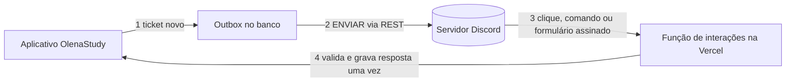

# Atendimento e futura ponte com Discord

## Estado em 18/10/2026

Preparação interna, não integração ativa. `src/backend/support-integration.ts` define um
evento versionado e uma interface de transporte exclusivamente no servidor. A configuração
está desativada. Não existe chamada ao Discord, webhook, bot, canal, token, job, fila de
reenvio em produção ou endpoint de resposta externo. O chat do aplicativo não depende desse
módulo. Nenhum conteúdo de ticket é encaminhado a terceiros por esta preparação.

O atendimento atual em desenvolvimento mantém uma conversa por conta, autorização pelo UID
verificado e respostas da equipe no próprio app. A atualização da tela é periódica, não push.
A equipe autorizada do aplicativo não se torna automaticamente equipe autorizada no Discord.

## Decisões da base

- O banco do aplicativo permanece a fonte do histórico. Discord será canal de atendimento,
  não o único lugar onde a mensagem existe.
- Evento contém somente versão, ticket opaco, mensagem, texto e horário. Não inclui UID,
  e-mail, token de login, cadernos ou histórico de estudos. O texto livre ainda pode conter
  informações pessoais e deve ser tratado como privado.
- Chave estável por ticket e mensagem permite rastrear tentativas. Isso não garante entrega
  única no Discord: a implementação precisará reconciliar falhas de resposta após envio.
- Respostas da equipe não geram novos eventos de saída para evitar ciclos.
- Texto permanece texto. O futuro adaptador deverá impedir menções, escapar formatação e
  não executar HTML nem abrir links enviados pelo usuário.

## Implementação necessária antes de ativar

1. A proprietária cria servidor privado, aplicativo do bot e permissões mínimas. IDs do
   servidor, canal e atendentes são configurados no servidor, não por nomes ou cargos editáveis.
   Segredos ficam em variáveis protegidas, nunca no frontend, Git, ticket ou logs.
2. Aprovar a informação de privacidade para explicar o encaminhamento ao Discord, acesso,
   retenção e exclusão. Não encaminhar tickets históricos automaticamente.
3. Gravar uma outbox na mesma operação atômica da mensagem confirmada, antes de qualquer
   envio externo. Não implementar apenas um fetch após salvar: falhas perderiam a entrega.
   A outbox deve conter referência ao conteúdo, não outra cópia permanente da conversa.
4. Worker com lease/CAS, tentativas limitadas, backoff, estado pendente/enviado/falhou e
   limites por conta e globais. Worker revalida existência/expiração da conversa antes de
   enviar. Cancelar pendências ao excluir a conta. Definir limpeza efetiva no banco e no Discord,
   incluindo expiração, sem confundir TTL lógico com exclusão física agendada.
5. Mapear ticket para conversa privada no Discord e reconciliar IDs externos. Não expor
   hash de ticket como autorização; só identidades verificadas têm acesso.
6. Para responder: validar assinatura de cada interação, timestamp contra replay e IDs de
   servidor/canal/atendente. Validar o vínculo do ticket no servidor, persistir a resposta com
   idempotência pelo ID da interação e registrar o autor para auditoria restrita. Nunca aceitar
   `from: team`, UID ou papel fornecido pelo navegador como prova de autorização.
7. Limitar tamanho, quantidade, frequência e custo. Falha no Discord não apaga mensagem
   salva nem transforma resposta recebida em sucesso sem persistência. Exibir status honesto.
8. Testar respostas duplicadas, concorrência, bot offline, limites do provedor, remoção de
   acesso de atendente, assinatura inválida, conta excluída durante entrega e exclusão do canal.
   Fazer ensaio em servidor de testes antes de habilitar para usuários.

## Modelo de ameaça

Conteúdo e IDs recebidos são não confiáveis. Riscos principais: leitura entre contas,
resposta falsa de atendente, spam de menções, replay, vazamento por canal público ou logs,
entrega duplicada e retenção após exclusão. O contrato preparado não resolve esses riscos
sozinho. A ativação exige os controles e testes acima e uma mudança própria revisada.

Nenhuma infraestrutura deve ser criada ou ativada automaticamente nesta etapa.

## Decisão de 25/10/2026: bot por requisição, sem processo ligado

Decisão da proprietária: o bot funciona por requisições HTTP, sem servidor ligado 24 horas.
Continua sendo preparação. Nenhum bot, token, endereço de interações ou canal foi criado.

### Por que não um bot sempre ligado

Pesquisa de 25/10/2026, feita em guias de terceiros (não em páginas oficiais, salvo onde dito).
O que cada opção gratuita ofereceria, e por que não vale a pena para o atendimento:

| Opção                         | Situação segundo as fontes                                 | Problema para este uso                                                                                                                                                                   |
| ----------------------------- | ---------------------------------------------------------- | ---------------------------------------------------------------------------------------------------------------------------------------------------------------------------------------- |
| Oracle Cloud Always Free      | Máquina Linux sempre ligada                                | Pode parar por ociosidade (uso abaixo de 20% por 7 dias), oferta ARM reduzida em 2026 com datas divergentes entre fontes, cadastro às vezes recusado, exige cartão e manutenção do Linux |
| Google Cloud e2-micro         | Uma VM gratuita em três regiões dos EUA                    | IPv4 externo pode custar cerca de US$ 3,65 por mês, exige cartão e manutenção; página oficial não conferida                                                                              |
| Fly.io                        | Sem plano gratuito para contas novas desde outubro de 2024 | Menor máquina sempre ligada custa cerca de US$ 2,19 por mês                                                                                                                              |
| Koyeb, Render, Replit, Glitch | Planos gratuitos dormem                                    | Não mantêm conexão 24 horas                                                                                                                                                              |
| Hosts de bot de terceiros     | Oferta dos próprios vendedores, não verificada             | Muitos exigem renovação a cada 1 a 7 dias                                                                                                                                                |

Todos os valores e limites acima são **não verificados** em fonte oficial. Conferir na página de cada
provedor antes de qualquer decisão paga.

### Como funciona por requisição

- **Enviar:** o servidor chama a API REST do Discord (mensagem no canal ou conversa privada do
  ticket). É uma chamada comum, sem conexão aberta. Parte da outbox descrita acima.
- **Receber:** o Discord chama um endereço do servidor (Interactions Endpoint URL) a cada botão,
  comando de barra ou formulário. A função confere a assinatura Ed25519 do corpo bruto
  (cabeçalhos `X-Signature-Ed25519` e `X-Signature-Timestamp`), recusa timestamp antigo, responde
  ao PING de verificação e responde à interação em até 3 segundos, usando resposta adiada quando o
  trabalho for maior. Conferir esses detalhes na documentação atual do Discord ao implementar.
- A função roda no mesmo projeto da Vercel das demais rotas `/api`, só quando algo acontece.

### O que este modelo não faz

Por não manter conexão com o Discord, o bot **não lê mensagens comuns** de canais como `general`,
não vê quem está online, não reage a entradas no servidor e não toca voz. Moderação automática
de chat não é possível assim. Se um dia isso for necessário, será um serviço próprio, com os
custos e riscos da tabela acima, em mudança separada.

### Mapa proposto dos canais (a confirmar pela proprietária)

Os papéis abaixo vieram dos nomes dos canais e não de uma decisão registrada.

| Canal                                           | Papel proposto                                                                 | Mecanismo                                                         |
| ----------------------------------------------- | ------------------------------------------------------------------------------ | ----------------------------------------------------------------- |
| `ticket` (SUPPORT)                              | Um ticket vira uma conversa privada; a equipe responde por botão ou formulário | Enviar e receber                                                  |
| `support` (LOG)                                 | Aviso de ticket novo para a equipe                                             | Enviar                                                            |
| `verify`                                        | Botão Verificar concede o cargo de membro                                      | Receber                                                           |
| `commands` (GERAL)                              | Comandos de barra, como /ajuda                                                 | Receber                                                           |
| `updates` (BOARD)                               | Novidades do app publicadas pelo bot                                           | Enviar                                                            |
| `account`, `cards`, `achievement`, `tags` (LOG) | Eventos agregados do app                                                       | Enviar, **somente depois** de aprovar a informação de privacidade |
| `general`, `images`, `partner`                  | Livres, sem bot                                                                | Nenhum                                                            |

Regra para os canais de LOG: nunca nome, e-mail, UID ou conteúdo de caderno. Evento de conta e de
conquista identifica a pessoa e exige o aviso de privacidade e o consentimento do item 2 acima.

### Ordem de entrega

1. **Proprietária (fora do repositório):** criar o servidor de testes, o aplicativo do bot e as
   permissões mínimas, guardar token e chave pública em variáveis protegidas da Vercel. Uma IA
   descreve o passo e confere o resultado, sem criar nem expor credenciais.
2. **Mudança própria e revisada:** outbox atômica, função de interações, limites por conta e
   globais, revisão de privacidade e os testes do item 8. Só o fluxo de tickets na primeira etapa.
3. Ensaio em servidor de testes, depois ativação para usuários.

### Custos e limites

Toda chamada ao Discord e toda função de interações precisa de limite por quem chama e teto
global (ver `docs/OPERACAO_E_CUSTOS.md`). Não verificado: limites de execução e termos do plano
gratuito da Vercel para este uso. O uso comercial do plano gratuito já é uma pergunta aberta da
proprietária em `docs/OPERACAO_E_CUSTOS.md`.
\n

### Etapa 1 entregue: endpoint de interações (2026-10-25)

Entregue só a base do "Receber". Ainda não há envio de tickets, comandos nem moderação.

- Endereço: `POST /api/olena?action=discord-interactions`. Reaproveita a função `api/olena.ts`
  (mesmo padrão do suporte), então não cria uma função nova na Vercel.
- Código: `src/backend/discord-interactions.ts` (validação e respostas) e
  `src/backend/discord-interactions-runtime.ts` (lê as variáveis). Assinatura Ed25519 conferida
  com `node:crypto`, sem dependência nova.
- Ordem das checagens: método POST, chave pública configurada (sem ela responde 503 e recusa
  tudo), tamanho do corpo (16 KiB), assinatura (401), janela do carimbo de tempo de 5 minutos
  contra reenvio (401), JSON, e só então o tipo da interação. PING recebe PONG.
- Servidores: interação de servidor que não está em `DISCORD_ALLOWED_GUILD_IDS`, ou de mensagem
  direta, recebe uma resposta só para quem chamou dizendo que o bot não atende ali.
- Nesta etapa, no servidor atendido, a resposta é "O atendimento por aqui ainda não está ativo."
- Variáveis na Vercel (produção): `DISCORD_APPLICATION_ID`, `DISCORD_PUBLIC_KEY`,
  `DISCORD_BOT_TOKEN` (já criadas pela proprietária; o token ainda não é usado por este código) e
  `DISCORD_ALLOWED_GUILD_IDS` (IDs dos servidores, separados por vírgula, **ainda a criar**).
- Passo da proprietária depois do deploy: colar a URL completa em _Interactions Endpoint URL_ no
  portal do Discord. O portal envia um PING e só salva se a resposta for válida.
- Custo e limite: o pedido inválido é recusado antes de tocar em banco, então só gasta uma
  execução curta. Ainda **não há teto global de execuções** nem limite por origem no endpoint; a
  Vercel Firewall é a camada atual. Ficam como pendência antes de ligar o atendimento.
- Não verificado: o PING real do portal do Discord contra o endereço publicado e os limites de
  execução do plano gratuito da Vercel.

### Etapa 1b: comandos /ajuda e /status (2026-10-26)

- O endpoint responde aos comandos de barra `/ajuda` e `/status` só para quem chamou (mensagem
  efêmera) e com `allowed_mentions` vazio, então nenhuma menção é processada. A resposta continua
  dizendo que o atendimento por aqui ainda não está ativo.
- Comando fora da lista, nomes que imitam propriedades de objeto e comandos de usuário ou de
  mensagem recebem "Comando desconhecido.". Servidor fora de `DISCORD_ALLOWED_GUILD_IDS` segue
  recusado antes de qualquer comando.
- Os comandos registrados no Discord ficam em `scripts/discord-commands.json`. Um teste garante
  que o JSON e `DISCORD_COMMAND_REPLIES` têm os mesmos nomes.
- Registro: `scripts/register-discord-commands.mjs`, rodado **pela proprietária** no computador
  dela (a rede das sessões de desenvolvimento não alcança o Discord). Usa `DISCORD_BOT_TOKEN`,
  `DISCORD_APPLICATION_ID` e `DISCORD_GUILD_ID` de variáveis de ambiente, nunca imprime o token e
  substitui a lista de comandos daquele servidor. Registro por servidor aparece na hora.
- Não verificado: o registro e os comandos funcionando no servidor de testes, até a proprietária
  rodar o script e testar.
